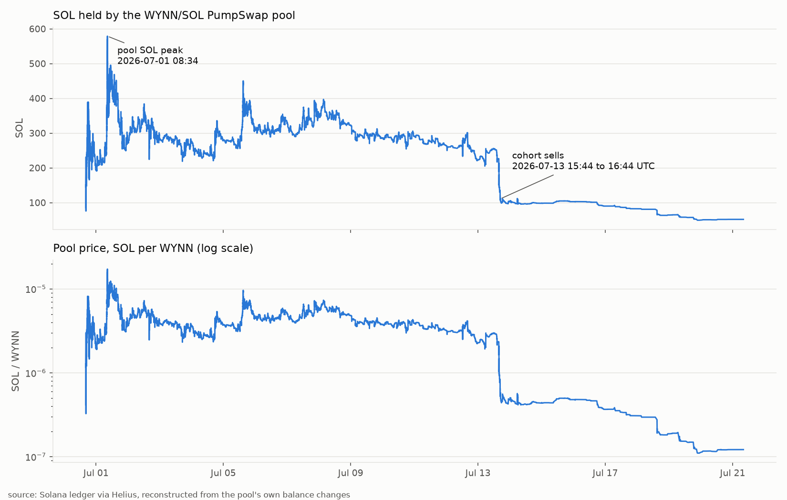
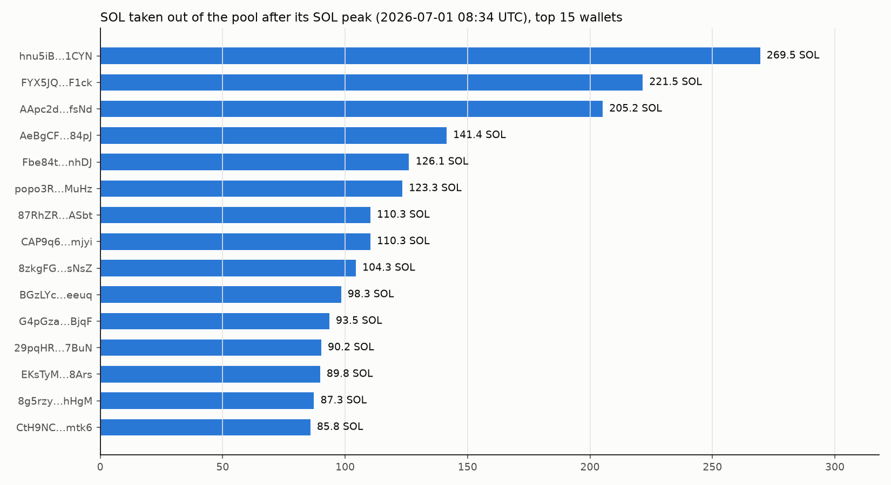

# On-chain record of the WYNN ("The White Bull") token

Prepared 2026-11-01 18:46:34 UTC from the public Solana ledger. Token mint [`9E2Q4KKxLS5Y4bu6RKvjg5wQ2kzaLkiVsMt7zwMZpump`](https://solscan.io/account/9E2Q4KKxLS5Y4bu6RKvjg5wQ2kzaLkiVsMt7zwMZpump).

Every transaction cited below is a permanent public record; click any signature to view it on Solscan. The method and limitations are in the last section. Figures are in SOL (the native asset); SOL/USD at the relevant dates can be added from any exchange record. Where the record says 'before' or 'after the peak', the reference point is the transaction after which the pool held the most SOL it ever held ([4jiJ8r4B…](https://solscan.io/tx/4jiJ8r4BcosqCNekkQCEfPGM8zpucaPGjSybG3jrN1LSXijTvUycXEw9SBaTHVsoW81FTwXMgEdQfuaabPPe5jJR), 2026-07-01 08:34:19 UTC); it is derived from the ledger, not chosen.

## 1. Summary

- WYNN was created on pump.fun at 2026-06-30 15:51:16 UTC by wallet [`8z4KS7…Z6vV`](https://solscan.io/account/8z4KS7H3g1rmewoTLaqjRwGN5MSTSVmdabjDqKdgZ6vV) ([s9oNPKRc…](https://solscan.io/tx/s9oNPKRcUBCVDfZoxZ9czLpeGGRZ9hx6Z6Akvf7cNyNR4vziPjrSiFqGCeS1gHvUeThdhqe1vuw8LBpzsXDnXdg)), which bought 151.7M tokens (15.2% of supply) for 5.010 SOL in the creation transaction itself.
- The bonding curve filled and the token migrated to a PumpSwap pool [`77WQKX…j91L`](https://solscan.io/account/77WQKX8D7e89LZXLk3qus2Xmqn4tNQjJrL6kwjDpj91L) at 2026-06-30 16:23:56 UTC ([5cG5bhaG…](https://solscan.io/tx/5cG5bhaGM7uhnMkph4Bq4h1mPEqh9njzrBTPGtx22rc4TXgJSBq9RDZFHsvh7bbMKTeetv1zD618uCcfSMpWbzv4)), 33 minutes after creation, with 85.49 SOL and 205.7M WYNN.
- The pool's SOL balance peaked at 578.96 SOL at 2026-07-01 08:34:19 UTC ([4jiJ8r4B…](https://solscan.io/tx/4jiJ8r4BcosqCNekkQCEfPGM8zpucaPGjSybG3jrN1LSXijTvUycXEw9SBaTHVsoW81FTwXMgEdQfuaabPPe5jJR)), 16.2 hours after migration; the pool price was then 1.723e-05 SOL/WYNN, 41x the price at migration.
- In the 72 hours after the peak, 2466 wallets sold 1,016.4M WYNN into the pool and withdrew 6,061.84 SOL. Over the whole period since, 10,618.91 SOL left the pool through sells by 4052 wallets.
- The 20 largest sellers account for 22.2% of all SOL withdrawn after the peak; 11 of them already held WYNN at the peak, and 1 of them bought on the bonding curve within the first 33 minutes of the token's existence.
- Today the pool holds 31.80 SOL against 694.1M WYNN (84.7% of the remaining supply sits unsold in the pool). The price is 4.582e-08 SOL/WYNN, 99.73% below the price at the peak.
- Holder concentration at the peak: the single largest non-pool holder had 16.27% of supply, the top 10 held 49.18%, the top 20 held 65.55%.
- **The cohort of early large buyers.** 35 wallets (creator excluded; called 'the cohort' below) each held at least 5M WYNN when the token migrated; together they held 62.0% of the total supply, bought on the bonding curve in the 33 minutes before migration for a combined 62.9 SOL. 20 of them made exactly one purchase ever, never bought again, and still held 47.4% of supply at the peak, when the pool price was 185x their average entry price. All 35 cohort wallets have since sold to zero; the cohort took 610.0 SOL out of the pool in total.
- **2026-07-13.** On 2026-07-13 between 15:44 and 16:44 UTC, cohort wallets sold 124.6M WYNN for 139.6 SOL; the pool fell from 250.3 SOL to 101.8 SOL in four hours and never recovered.
- **Exits within minutes of one another.** On 2026-09-06, 10 different cohort wallets each sold their entire remaining balance within 18 minutes of one another (13:48 to 14:06 UTC). These wallets were funded from the same source, bought in the same minutes and never traded otherwise. Whether they had one controller is a question for the records of the exchange that funded them (section 7); the ledger shows the timing.
- **Common funding.** 20 of the 35 cohort wallets received their very first SOL from the same address [`iGdFcQ…Sdwu`](https://solscan.io/account/iGdFcQoyR2MwbXMHQskhmNsqddZ6rinsipHc4TNSdwu), which Solscan names **Bybit Wallet 10**; 14 of them were funded in the hours before WYNN was created (between 09:42 and 15:39 UTC on 2026-06-30), with 1 to 5 SOL each, which they then spent on the bonding curve. The creator wallet was funded with 94.2 SOL by **KuCoin Hot Wallet** 52 minutes before creating the token. The exchanges' customer records identify who withdrew to these addresses at these times (section 7).
- **Other launches by the creator wallet.** The creator wallet created 6 pump.fun coins between 2026-06-30 and 2026-07-13, three of them within 49 minutes on 2026-06-30 (WYNN was the third). On 2026-07-13 it sold out of its 2026-07-06 coin at 15:37 UTC and launched a new one at 15:45 UTC, spending 77 SOL to buy 77% of its supply, in the same minutes in which the cohort wallets sold WYNN (section 6a).
- The creator sold its entire 151.7M dev-buy on the bonding curve at 2026-06-30 16:06:46 UTC, in the middle of the window in which the cohort wallets were buying, then bought back in with the purchase that completed the bonding curve, bought a further 56.8M on the pool for 239.0 SOL, and burned 180.2M WYNN on 2026-07-12 12:24:11 UTC, the day before the sells of 2026-07-13 (section 4).
- **The account's statements match the creator wallet's transactions.** The X account @JamesWynnReal posted, within minutes of each, statements describing transactions of the creator wallet, including amounts and a new mint address that did not exist before the transaction: 5 such matches between 2026-06-30 and 2026-07-13, including the burn of exactly 18% of supply and the creation of its next coin $MIX in the minute the cohort wallets began selling WYNN. It also wrote "I created it, you bought it" on 2026-07-04. Posts, timestamps and signatures: `x_posts.md`. 1,863 of the account's posts (2026-04 to 2026-10) are preserved in `exhibits/x_posts/`, 169 of them about the token.
- **Aggregate losses.** Across every wallet that ever bought WYNN, 2,659 wallets other than the creator and the cohort ended with a net loss, 2,317 SOL in total (176,178 USD at the SOL price of the day they traded; median 0.11 SOL); 2,397 of them bought for the first time after the post of 16:42 UTC in section 3. The 35 cohort wallets netted +455 SOL. Per-wallet table and method: `buyer_losses.md`, `exhibits/buyer_losses.csv`.

## 2. The token

| Item | Value |
|---|---|
| Name / symbol | The White Bull / WYNN |
| Mint address | [`9E2Q4KKxLS5Y4bu6RKvjg5wQ2kzaLkiVsMt7zwMZpump`](https://solscan.io/account/9E2Q4KKxLS5Y4bu6RKvjg5wQ2kzaLkiVsMt7zwMZpump) |
| Token program | `TokenzQdBNbLqP5VEhdkAS6EPFLC1PHnBqCXEpPxuEb` (Token-2022) |
| Extensions | metadataPointer, tokenMetadata |
| Mint authority / freeze authority | None / None (both revoked: supply cannot be inflated, accounts cannot be frozen) |
| Supply now | 819,567,770 of 1,000,000,000 minted; 180,432,230 burned |
| Metadata URI | https://ipfs.io/ipfs/bafkreiccewxo2majwlizxn7zmsub53u6fxnw44pnerdsvmvpemfvjfejom |
| Creator (fee payer of creation tx) | [`8z4KS7H3g1rmewoTLaqjRwGN5MSTSVmdabjDqKdgZ6vV`](https://solscan.io/account/8z4KS7H3g1rmewoTLaqjRwGN5MSTSVmdabjDqKdgZ6vV) |
| Creation transaction | [s9oNPKRcUBCVDfZoxZ9czLpeGGRZ9hx6Z6Akvf7cNyNR4vziPjrSiFqGCeS1gHvUeThdhqe1vuw8LBpzsXDnXdg](https://solscan.io/tx/s9oNPKRcUBCVDfZoxZ9czLpeGGRZ9hx6Z6Akvf7cNyNR4vziPjrSiFqGCeS1gHvUeThdhqe1vuw8LBpzsXDnXdg) |
| Bonding curve account | [`CU9AHnCa3Sw6TRd9bGTarwqnNmdoHwcSPSevNJm52mUS`](https://solscan.io/account/CU9AHnCa3Sw6TRd9bGTarwqnNmdoHwcSPSevNJm52mUS) |
| Migration transaction | [5cG5bhaGM7uhnMkph4Bq4h1mPEqh9njzrBTPGtx22rc4TXgJSBq9RDZFHsvh7bbMKTeetv1zD618uCcfSMpWbzv4](https://solscan.io/tx/5cG5bhaGM7uhnMkph4Bq4h1mPEqh9njzrBTPGtx22rc4TXgJSBq9RDZFHsvh7bbMKTeetv1zD618uCcfSMpWbzv4) |
| PumpSwap pool | [`77WQKX8D7e89LZXLk3qus2Xmqn4tNQjJrL6kwjDpj91L`](https://solscan.io/account/77WQKX8D7e89LZXLk3qus2Xmqn4tNQjJrL6kwjDpj91L) |
| Ledger coverage | 71,636 successful transactions touching the mint or the pool, 2026-06-30 15:51:16 UTC to 2026-10-31 08:22:20 UTC; 41,737 trades by 6,574 wallets |

Technical note: a pump.fun token's pool liquidity cannot be withdrawn (the migration LP is held by the protocol) or by freezing or minting (both authorities are null). The only way any holder could turn tokens into SOL was the one the ledger shows: sell them into the pool against the SOL that other buyers had put in.

## 3. The X account's posts of the mint address, set against the ledger

The X account @JamesWynnReal first posted the mint address at **2026-06-30 16:24:41 UTC** (https://x.com/JamesWynnReal/status/2071993333803798944; archive.today copy https://archive.ph/ZNsyM), 45 seconds after migration, and at **2026-06-30 16:42:52 UTC** posted the address with the name "The White Bull" and the words "Due to immense demand it had to be done. I didn't want to be that guy who did it. But, someone had to do it." (https://x.com/JamesWynnReal/status/2071997912545120318; screenshot in `screenshots/x_JamesWynnReal_2071997912545120318.jpg`, text as returned by X's public oEmbed endpoint in `exhibits/tweet_2071997912545120318_oembed.json`, archive.today copy https://archive.ph/aNLlk). X post ids encode their creation time; the two ids decode to the times given (the pages show the date "June 30, 2026"). The second post is the reference point for 'bought after the post' in `buyer_losses.md`. Set against the ledger:

| Time (UTC) | Minutes from first post | Event | Pool SOL | Price SOL/WYNN |
|---|---|---|---|---|
| 2026-06-30 15:51:16 | -33 | Token created by [`8z4KS7…Z6vV`](https://solscan.io/account/8z4KS7H3g1rmewoTLaqjRwGN5MSTSVmdabjDqKdgZ6vV) | curve | 5.823e-09 |
| 2026-06-30 16:23:56 | -1 | The 35 cohort wallets have bought 62% of supply on the bonding curve | 86.3 | 4.239e-07 |
| 2026-06-30 16:23:56 | -1 | Migration to the PumpSwap pool | 86.3 | 4.239e-07 |
| 2026-06-30 16:24:41 | +0 | **First post of the mint address by @JamesWynnReal** | 134.0 | 1.017e-06 |
| 2026-06-30 16:42:52 | +18 | **Post by @JamesWynnReal: "Due to immense demand ..."** | 152.2 | 1.279e-06 |
| 2026-06-30 17:49:18 | +85 | Pool peak of launch day | 389.3 | 8.181e-06 |
| 2026-07-01 08:34:19 | +970 | All-time peak of the pool's SOL balance ([4jiJ8r4B…](https://solscan.io/tx/4jiJ8r4BcosqCNekkQCEfPGM8zpucaPGjSybG3jrN1LSXijTvUycXEw9SBaTHVsoW81FTwXMgEdQfuaabPPe5jJR)) | 579.0 | 1.723e-05 |

The first post went out 33 minutes after the token was created and 45 seconds after migration, by which time the cohort in section 4a had already taken its position on the bonding curve. The posts do not by themselves show that the account holder controls the creator wallet or the cohort.

## 4. Launch structure and early positions

The bonding curve phase lasted 33 minutes: 151 buys by 103 wallets put in 133.66 SOL. The largest bonding-curve buyers (plus the creator's own dev buy) and what they later did:

| Wallet | First buy | WYNN bought on curve | % supply | SOL paid | SOL taken out after the peak |
|---|---|---|---|---|---|
| [`8z4KS7…Z6vV`](https://solscan.io/account/8z4KS7H3g1rmewoTLaqjRwGN5MSTSVmdabjDqKdgZ6vV) | 2026-06-30 16:23:56 | 127,036,634 | 12.70 | 35.902 | 0.40 |
| [`Eaa7Kc…iuC7`](https://solscan.io/account/Eaa7KcbuMrTRGPMeQADqtk1yn2PwcDPHAgfvwqc2iuC7) | 2026-06-30 16:08:49 | 43,328,212 | 4.33 | 2.128 | 9.47 |
| [`AHZV7Y…wCh9`](https://solscan.io/account/AHZV7YoHf7jrZik8nrog7CjoCP5BC5Aw7bxvHtYBwCh9) | 2026-06-30 16:10:35 | 43,186,980 | 4.32 | 2.634 | 62.60 |
| [`2b5rCm…FHwD`](https://solscan.io/account/2b5rCmrYjPb8nodpXwMuM6eDSaw4R4t4hXeRQhbfFHwD) | 2026-06-30 16:02:31 | 42,886,889 | 4.29 | 2.691 | 28.28 |
| [`Fnb9cg…1x63`](https://solscan.io/account/Fnb9cgXrwGawKY97tsxpXG6r4p9KkegoaaxHqCQr1x63) | 2026-06-30 16:12:46 | 41,371,385 | 4.14 | 3.111 | 7.17 |
| [`6cvAWi…Zuse`](https://solscan.io/account/6cvAWiQ7uE9Nebd1akLh5y1n8waYtEojMdxaQTfEZuse) | 2026-06-30 15:59:54 | 38,506,685 | 3.85 | 2.074 | 48.76 |
| [`CF39HS…V19W`](https://solscan.io/account/CF39HSYnDbvFcdeBpRVsvmHwQXLDwcKXWDzskDnrV19W) | 2026-06-30 16:15:15 | 35,260,541 | 3.53 | 3.447 | 4.82 |
| [`BGAWSh…RMTs`](https://solscan.io/account/BGAWShokkHm85ePZZXjgqqL4pS2xwTbBHfw4vQ27RMTs) | 2026-06-30 16:16:17 | 32,368,958 | 3.24 | 4.854 | 2.36 |
| [`6EfwaQ…eRQz`](https://solscan.io/account/6EfwaQGLGKKUGezfba9VP85mX4QME6jherpv8fKGeRQz) | 2026-06-30 15:51:39 | 31,460,124 | 3.15 | 1.284 | 0.00 |
| [`9MAUyG…jk5W`](https://solscan.io/account/9MAUyGmdjZL6gEXEr4bN5cSXKGQHtW5kYPrtmrdrjk5W) | 2026-06-30 15:56:45 | 29,924,347 | 2.99 | 2.134 | 0.29 |
| [`EoP6eP…DJi8`](https://solscan.io/account/EoP6ePqqq4SsJ3zJcM4fhFjNTR4Cgxmx6aK3DyJMDJi8) | 2026-06-30 15:57:46 | 28,783,706 | 2.88 | 1.244 | 45.99 |
| [`DCEdX1…KDax`](https://solscan.io/account/DCEdX1yDqwPEt4WwYgLZ3H95crPLse48oR99b13eKDax) | 2026-06-30 16:15:25 | 28,164,322 | 2.82 | 3.422 | 0.95 |
| [`9F46qi…Je72`](https://solscan.io/account/9F46qiTXmGiLK7TT8UdsrjDE15GzU2ChzUQtmToRJe72) | 2026-06-30 16:07:08 | 25,229,341 | 2.52 | 1.481 | 0.00 |
| [`HgcviF…FajD`](https://solscan.io/account/HgcviFxxjU61Ny4YbPAP3VhC2v2vfZP2Fq49iKkMFajD) | 2026-06-30 15:59:03 | 23,330,922 | 2.33 | 1.136 | 2.72 |
| [`GmvkSY…s8tj`](https://solscan.io/account/GmvkSYYtTp8mgCzd4yDxaZuhuucJUdRx74Js5jevs8tj) | 2026-06-30 16:13:48 | 20,997,777 | 2.10 | 1.795 | 1.69 |

### 4a. The cohort that held the supply at migration

Every wallet (creator excluded) holding at least 5M WYNN at the migration slot, with its full history. 'Curve price' is what the wallet paid per token on the bonding curve; at the pool's peak the price was 1.723e-05 SOL per token.

| Wallet | First (curve) buy | Curve buys | Pool buys | Held at migration | % supply | SOL paid on curve | Peak price / this wallet's price | Held at the peak | First sell | Last sell | SOL taken out | Balance now |
|---|---|---|---|---|---|---|---|---|---|---|---|---|
| [`Eaa7Kc…iuC7`](https://solscan.io/account/Eaa7KcbuMrTRGPMeQADqtk1yn2PwcDPHAgfvwqc2iuC7) | 2026-06-30 16:08:49 | 1 | 0 | 43,328,212 | 4.33 | 2.128 | 351x | 43,328,212 | 2026-07-18 15:05:28 | 2026-07-18 15:05:28 | 9.47 | 0 |
| [`AHZV7Y…wCh9`](https://solscan.io/account/AHZV7YoHf7jrZik8nrog7CjoCP5BC5Aw7bxvHtYBwCh9) | 2026-06-30 16:10:35 | 1 | 0 | 43,186,980 | 4.32 | 2.634 | 283x | 43,186,980 | 2026-07-13 15:49:20 | 2026-07-13 15:49:20 | 62.60 | 0 |
| [`2b5rCm…FHwD`](https://solscan.io/account/2b5rCmrYjPb8nodpXwMuM6eDSaw4R4t4hXeRQhbfFHwD) | 2026-06-30 16:02:31 | 1 | 0 | 42,886,889 | 4.29 | 2.691 | 275x | 42,886,889 | 2026-07-13 16:41:50 | 2026-07-13 16:41:50 | 28.28 | 0 |
| [`Fnb9cg…1x63`](https://solscan.io/account/Fnb9cgXrwGawKY97tsxpXG6r4p9KkegoaaxHqCQr1x63) | 2026-06-30 16:12:46 | 1 | 0 | 41,371,385 | 4.14 | 3.111 | 229x | 41,371,385 | 2026-07-19 07:56:28 | 2026-07-19 07:56:28 | 7.17 | 0 |
| [`6cvAWi…Zuse`](https://solscan.io/account/6cvAWiQ7uE9Nebd1akLh5y1n8waYtEojMdxaQTfEZuse) | 2026-06-30 15:59:54 | 1 | 0 | 38,506,685 | 3.85 | 2.074 | 320x | 38,506,685 | 2026-07-13 15:44:02 | 2026-07-13 16:44:21 | 48.76 | 0 |
| [`CF39HS…V19W`](https://solscan.io/account/CF39HSYnDbvFcdeBpRVsvmHwQXLDwcKXWDzskDnrV19W) | 2026-06-30 16:15:15 | 1 | 0 | 35,260,541 | 3.53 | 3.447 | 176x | 35,260,541 | 2026-07-19 18:48:03 | 2026-07-19 18:48:03 | 4.82 | 0 |
| [`BGAWSh…RMTs`](https://solscan.io/account/BGAWShokkHm85ePZZXjgqqL4pS2xwTbBHfw4vQ27RMTs) | 2026-06-30 16:16:17 | 1 | 0 | 32,368,958 | 3.24 | 4.854 | 115x | 32,368,958 | 2026-09-06 13:51:06 | 2026-09-06 13:51:06 | 2.36 | 0 |
| [`EoP6eP…DJi8`](https://solscan.io/account/EoP6ePqqq4SsJ3zJcM4fhFjNTR4Cgxmx6aK3DyJMDJi8) | 2026-06-30 15:57:46 | 1 | 0 | 28,783,706 | 2.88 | 1.244 | 399x | 28,783,706 | 2026-07-12 12:27:42 | 2026-07-18 15:01:31 | 45.99 | 0 |
| [`HgcviF…FajD`](https://solscan.io/account/HgcviFxxjU61Ny4YbPAP3VhC2v2vfZP2Fq49iKkMFajD) | 2026-06-30 15:59:03 | 1 | 0 | 23,330,922 | 2.33 | 1.136 | 354x | 23,330,922 | 2026-07-19 21:21:52 | 2026-07-19 21:21:52 | 2.72 | 0 |
| [`GmvkSY…s8tj`](https://solscan.io/account/GmvkSYYtTp8mgCzd4yDxaZuhuucJUdRx74Js5jevs8tj) | 2026-06-30 16:13:48 | 1 | 0 | 20,997,777 | 2.10 | 1.795 | 202x | 20,997,777 | 2026-09-06 13:49:43 | 2026-09-06 13:49:43 | 1.69 | 0 |
| [`Gw7fv5…y6Gs`](https://solscan.io/account/Gw7fv5zojRUVYRGm4iJChooczS3aMzeENebSzLvMy6Gs) | 2026-06-30 16:21:38 | 1 | 0 | 20,678,478 | 2.07 | 3.036 | 117x | 20,678,478 | 2026-09-06 13:53:55 | 2026-09-06 13:53:55 | 1.26 | 0 |
| [`EWxArR…MCEw`](https://solscan.io/account/EWxArRn8vo83ZoiXCGefBhWowa4LAXjvKPi3fQoXMCEw) | 2026-06-30 16:04:26 | 1 | 0 | 20,658,703 | 2.07 | 1.746 | 204x | 20,658,703 | 2026-09-06 14:05:12 | 2026-09-06 14:05:12 | 1.07 | 0 |
| [`6EfwaQ…eRQz`](https://solscan.io/account/6EfwaQGLGKKUGezfba9VP85mX4QME6jherpv8fKGeRQz) | 2026-06-30 15:51:39 | 2 | 0 | 18,809,421 | 1.88 | 1.284 | 422x | 0 | 2026-06-30 15:53:50 | 2026-06-30 18:04:03 | 55.96 | 0 |
| [`AxTcF2…Uvbt`](https://solscan.io/account/AxTcF2Si48fhvq6xNeLBscifQctsamqSsDEzGbrtUvbt) | 2026-06-30 16:11:39 | 1 | 0 | 17,866,002 | 1.79 | 1.229 | 251x | 17,866,002 | 2026-09-06 13:48:38 | 2026-09-06 13:48:38 | 1.55 | 0 |
| [`3zBXWM…gGCu`](https://solscan.io/account/3zBXWMvJzViSpWwaoWxeXptsw5nJcWpZbXG58kGngGCu) | 2026-06-30 16:03:31 | 1 | 0 | 16,223,584 | 1.62 | 1.260 | 222x | 16,223,584 | 2026-09-06 14:06:57 | 2026-09-06 14:06:57 | 0.80 | 0 |
| [`H47Bm2…MVJt`](https://solscan.io/account/H47Bm2h3CRKdzWUA8qCp1Qs2Su6X9HGK5eJmonDpMVJt) | 2026-06-30 16:22:40 | 1 | 0 | 15,909,577 | 1.59 | 2.770 | 99x | 15,909,577 | 2026-09-06 13:55:07 | 2026-09-06 13:55:07 | 0.92 | 0 |
| [`DCEdX1…KDax`](https://solscan.io/account/DCEdX1yDqwPEt4WwYgLZ3H95crPLse48oR99b13eKDax) | 2026-06-30 16:15:25 | 2 | 1 | 14,713,974 | 1.47 | 3.422 | 142x | 0 | 2026-06-30 16:20:22 | 2026-07-05 01:57:32 | 14.07 | 0 |
| [`Ahi8Mk…D7zd`](https://solscan.io/account/Ahi8Mk41upZBWpKw6DaHnnmJWZGPscYGtygJssq8D7zd) | 2026-06-30 16:21:20 | 1 | 14 | 14,282,713 | 1.43 | 1.975 | 125x | 17,246,472 | 2026-06-30 16:54:04 | 2026-07-13 14:24:24 | 90.73 | 0 |
| [`FyEYcy…rBpA`](https://solscan.io/account/FyEYcyNBTWMqXYaeKiPrdJQgCfSRWxLpTvqKjViArBpA) | 2026-06-30 16:05:40 | 1 | 0 | 14,018,269 | 1.40 | 1.457 | 166x | 14,018,269 | 2026-09-06 13:56:43 | 2026-09-06 13:56:43 | 0.77 | 0 |
| [`3oBfdV…Gq5Z`](https://solscan.io/account/3oBfdVPCVUA3XgYojUmRU2k5DqhsFFKrz8htzLMvGq5Z) | 2026-06-30 15:58:16 | 2 | 2 | 11,983,919 | 1.20 | 1.033 | 200x | 0 | 2026-06-30 16:24:44 | 2026-06-30 21:10:35 | 31.69 | 0 |
| [`FzaU6z…QxwJ`](https://solscan.io/account/FzaU6zpeXCS3sDL561TsV2nM76SyhnhwnJNRSdjhQxwJ) | 2026-06-30 16:18:25 | 1 | 0 | 10,255,304 | 1.03 | 1.828 | 97x | 10,255,304 | 2026-09-06 13:52:52 | 2026-09-06 13:52:52 | 0.67 | 0 |
| [`2KJGEN…jesJ`](https://solscan.io/account/2KJGENZvkazt6q4oLx6YBHWDrc6vMGFofYFe8T2bjesJ) | 2026-06-30 15:58:16 | 3 | 2 | 9,045,942 | 0.90 | 1.093 | 283x | 2,047,525 | 2026-06-30 16:07:58 | 2026-07-02 17:55:10 | 23.74 | 0 |
| [`7A7Djn…g8eE`](https://solscan.io/account/7A7DjnCzda2KsY38iwzefksyhZbc19o7GzuuGkBVg8eE) | 2026-06-30 16:17:56 | 2 | 1 | 8,939,346 | 0.89 | 2.444 | 103x | 0 | 2026-06-30 16:20:22 | 2026-07-05 01:57:32 | 8.52 | 0 |
| [`FTR265…ZkKH`](https://solscan.io/account/FTR265cBKXjehnEUCzAEJpTd9mHvQW8MTyLb3gpZZkKH) | 2026-06-30 16:17:22 | 1 | 0 | 8,575,226 | 0.86 | 1.396 | 106x | 8,575,226 | 2026-09-06 13:52:20 | 2026-09-06 13:52:20 | 0.58 | 0 |
| [`8jzAfK…UaBp`](https://solscan.io/account/8jzAfKWPegyNFwCUqxewA6mHLTZNaNiVYJmbYQskUaBp) | 2026-06-30 15:58:16 | 3 | 2 | 8,364,857 | 0.84 | 1.092 | 318x | 0 | 2026-06-30 15:58:55 | 2026-06-30 19:25:41 | 14.69 | 0 |
| [`8LgvxN…G7o1`](https://solscan.io/account/8LgvxNrqWdXLZzd7bpaW12W7v2Z337zcupPw8gDG7o1) | 2026-06-30 16:00:40 | 1 | 0 | 7,491,467 | 0.75 | 0.428 | 301x | 0 | 2026-06-30 16:24:47 | 2026-06-30 16:57:55 | 11.27 | 0 |
| [`DTZXHS…6eUU`](https://solscan.io/account/DTZXHSNwFy5vBpQtt2nr4YWyYegurCJLnLBbso8m6eUU) | 2026-06-30 16:03:48 | 1 | 0 | 6,683,512 | 0.67 | 0.538 | 214x | 0 | 2026-06-30 16:24:47 | 2026-06-30 18:46:38 | 26.10 | 0 |
| [`9MAUyG…jk5W`](https://solscan.io/account/9MAUyGmdjZL6gEXEr4bN5cSXKGQHtW5kYPrtmrdrjk5W) | 2026-06-30 15:56:45 | 2 | 0 | 6,173,422 | 0.62 | 2.134 | 242x | 6,173,422 | 2026-06-30 16:07:53 | 2026-09-07 03:33:57 | 1.55 | 0 |
| [`FpNP1k…1Fua`](https://solscan.io/account/FpNP1kPGkb6mWE3Rzpt1rCsxZbX4TszhazGrexkF1Fua) | 2026-06-30 16:03:51 | 5 | 0 | 5,950,076 | 0.60 | 0.692 | 220x | 0 | 2026-06-30 16:07:46 | 2026-06-30 16:24:33 | 3.51 | 0 |
| [`73K47U…fcuN`](https://solscan.io/account/73K47UMr5hqpsrZxALPkCrGwggZwXTQMWxNjMAtXfcuN) | 2026-06-30 16:03:11 | 4 | 0 | 5,921,582 | 0.59 | 0.748 | 270x | 0 | 2026-06-30 16:06:47 | 2026-06-30 16:26:34 | 8.44 | 0 |
| [`omegoM…XAfq`](https://solscan.io/account/omegoMAe1AMY5MFKQQr3JwXVy8F4eCvmBAfcpo8XAfq) | 2026-06-30 16:15:16 | 3 | 0 | 5,873,335 | 0.59 | 2.134 | 150x | 0 | 2026-06-30 16:15:21 | 2026-06-30 16:36:36 | 10.38 | 0 |
| [`CqjtXJ…H9Nx`](https://solscan.io/account/CqjtXJKbLtc8Vum9nB8ozyr12Wqd4oGkb9XVF6UxH9Nx) | 2026-06-30 16:03:11 | 4 | 0 | 5,761,764 | 0.58 | 0.733 | 268x | 0 | 2026-06-30 16:06:47 | 2026-06-30 16:26:34 | 8.21 | 0 |
| [`FRxgt1…N3j7`](https://solscan.io/account/FRxgt14uG5xmAJJvQKDUKuEV8PBvyi1kCCmDw5A6N3j7) | 2026-06-30 16:05:21 | 2 | 7 | 5,248,929 | 0.52 | 0.494 | 183x | 0 | 2026-06-30 17:33:04 | 2026-07-01 02:08:39 | 71.23 | 0 |
| [`7dyrVB…4EUD`](https://solscan.io/account/7dyrVBAchXbSMjyPR2zAerAzpCZ19UfhvawSEc1P4EUD) | 2026-06-30 16:03:51 | 5 | 0 | 5,067,078 | 0.51 | 0.589 | 220x | 0 | 2026-06-30 16:07:46 | 2026-06-30 16:24:33 | 3.02 | 0 |
| [`HLZDrG…q9nd`](https://solscan.io/account/HLZDrG7CCZte8e81f3ZGKUcnH1i21B7xMX7qWwnPq9nd) | 2026-06-30 16:15:39 | 2 | 0 | 5,048,378 | 0.50 | 2.254 | 121x | 0 | 2026-06-30 16:20:22 | 2026-06-30 16:24:52 | 5.39 | 0 |

Cohort totals: 62.0% of supply at migration for 62.9 SOL; 50.0% of supply still held at the peak; 610.0 SOL taken out (325.8 SOL of it after the peak); 35 of 35 wallets now hold nothing.

### 4b. Exits within the same minutes

Cohort sells grouped into windows (a window extends while the next cohort sell is within 30 minutes; only windows with two or more distinct wallets are shown):

| Start (UTC) | End | Minutes | Wallets | Sells | WYNN sold | SOL taken out |
|---|---|---|---|---|---|---|
| 2026-06-30 15:53:50 | 2026-06-30 19:25:41 | 211.8 | 18 | 184 | 403,389,082 | 268.63 |
| 2026-07-13 15:44:02 | 2026-07-13 15:49:20 | 5.3 | 2 | 2 | 62,440,375 | 100.09 |
| 2026-07-13 16:41:50 | 2026-07-13 16:44:21 | 2.5 | 2 | 2 | 62,140,179 | 39.55 |
| 2026-06-30 21:03:18 | 2026-06-30 21:30:16 | 27.0 | 2 | 4 | 7,030,352 | 23.00 |
| 2026-07-18 15:01:31 | 2026-07-18 15:05:28 | 4.0 | 2 | 2 | 57,720,065 | 13.07 |
| 2026-09-06 13:48:38 | 2026-09-06 14:06:57 | 18.3 | 10 | 10 | 177,551,877 | 11.67 |
| 2026-07-05 01:57:32 | 2026-07-05 01:57:32 | 0.0 | 2 | 2 | 554,308 | 1.98 |

Wallets in the 2026-06-30 15:53:50 window: [`6EfwaQ…eRQz`](https://solscan.io/account/6EfwaQGLGKKUGezfba9VP85mX4QME6jherpv8fKGeRQz), [`8jzAfK…UaBp`](https://solscan.io/account/8jzAfKWPegyNFwCUqxewA6mHLTZNaNiVYJmbYQskUaBp), [`8z4KS7…Z6vV`](https://solscan.io/account/8z4KS7H3g1rmewoTLaqjRwGN5MSTSVmdabjDqKdgZ6vV), [`CqjtXJ…H9Nx`](https://solscan.io/account/CqjtXJKbLtc8Vum9nB8ozyr12Wqd4oGkb9XVF6UxH9Nx), [`73K47U…fcuN`](https://solscan.io/account/73K47UMr5hqpsrZxALPkCrGwggZwXTQMWxNjMAtXfcuN), [`FpNP1k…1Fua`](https://solscan.io/account/FpNP1kPGkb6mWE3Rzpt1rCsxZbX4TszhazGrexkF1Fua), [`7dyrVB…4EUD`](https://solscan.io/account/7dyrVBAchXbSMjyPR2zAerAzpCZ19UfhvawSEc1P4EUD), [`9MAUyG…jk5W`](https://solscan.io/account/9MAUyGmdjZL6gEXEr4bN5cSXKGQHtW5kYPrtmrdrjk5W), [`2KJGEN…jesJ`](https://solscan.io/account/2KJGENZvkazt6q4oLx6YBHWDrc6vMGFofYFe8T2bjesJ), [`omegoM…XAfq`](https://solscan.io/account/omegoMAe1AMY5MFKQQr3JwXVy8F4eCvmBAfcpo8XAfq), [`HLZDrG…q9nd`](https://solscan.io/account/HLZDrG7CCZte8e81f3ZGKUcnH1i21B7xMX7qWwnPq9nd), [`DCEdX1…KDax`](https://solscan.io/account/DCEdX1yDqwPEt4WwYgLZ3H95crPLse48oR99b13eKDax), [`7A7Djn…g8eE`](https://solscan.io/account/7A7DjnCzda2KsY38iwzefksyhZbc19o7GzuuGkBVg8eE), [`3oBfdV…Gq5Z`](https://solscan.io/account/3oBfdVPCVUA3XgYojUmRU2k5DqhsFFKrz8htzLMvGq5Z), [`8LgvxN…G7o1`](https://solscan.io/account/8LgvxNrqWdXLZzd7bpaW12W7v2Z337zcupPw8gDG7o1), [`DTZXHS…6eUU`](https://solscan.io/account/DTZXHSNwFy5vBpQtt2nr4YWyYegurCJLnLBbso8m6eUU), [`Ahi8Mk…D7zd`](https://solscan.io/account/Ahi8Mk41upZBWpKw6DaHnnmJWZGPscYGtygJssq8D7zd), [`FRxgt1…N3j7`](https://solscan.io/account/FRxgt14uG5xmAJJvQKDUKuEV8PBvyi1kCCmDw5A6N3j7)

Wallets in the 2026-09-06 13:48:38 window: [`AxTcF2…Uvbt`](https://solscan.io/account/AxTcF2Si48fhvq6xNeLBscifQctsamqSsDEzGbrtUvbt), [`GmvkSY…s8tj`](https://solscan.io/account/GmvkSYYtTp8mgCzd4yDxaZuhuucJUdRx74Js5jevs8tj), [`BGAWSh…RMTs`](https://solscan.io/account/BGAWShokkHm85ePZZXjgqqL4pS2xwTbBHfw4vQ27RMTs), [`FTR265…ZkKH`](https://solscan.io/account/FTR265cBKXjehnEUCzAEJpTd9mHvQW8MTyLb3gpZZkKH), [`FzaU6z…QxwJ`](https://solscan.io/account/FzaU6zpeXCS3sDL561TsV2nM76SyhnhwnJNRSdjhQxwJ), [`Gw7fv5…y6Gs`](https://solscan.io/account/Gw7fv5zojRUVYRGm4iJChooczS3aMzeENebSzLvMy6Gs), [`H47Bm2…MVJt`](https://solscan.io/account/H47Bm2h3CRKdzWUA8qCp1Qs2Su6X9HGK5eJmonDpMVJt), [`FyEYcy…rBpA`](https://solscan.io/account/FyEYcyNBTWMqXYaeKiPrdJQgCfSRWxLpTvqKjViArBpA), [`EWxArR…MCEw`](https://solscan.io/account/EWxArRn8vo83ZoiXCGefBhWowa4LAXjvKPi3fQoXMCEw), [`3zBXWM…gGCu`](https://solscan.io/account/3zBXWMvJzViSpWwaoWxeXptsw5nJcWpZbXG58kGngGCu)

### 4c. The creator wallet

Creator wallet [`8z4KS7…Z6vV`](https://solscan.io/account/8z4KS7H3g1rmewoTLaqjRwGN5MSTSVmdabjDqKdgZ6vV): dev buy 151,660,777 WYNN; 
| Time | Tx | Venue | Side | WYNN | SOL | Price |
|---|---|---|---|---|---|---|
| 2026-06-30 16:06:46 | [25T84R8d…](https://solscan.io/tx/25T84R8diDipRR2BXjHfgoDGBCNkmjA7pwUZoNfbEowh2uVm7YX5CHUPcaNtQGStCB4WiCXCcZdkYL3TMXsSxh3K) | bonding_curve | sell | 151,660,777 | 12.793 | 8.435e-08 |
| 2026-06-30 16:23:56 | [5GJYpWE1…](https://solscan.io/tx/5GJYpWE1ywikxmPjttFToARcPWSYwLi7p9xX7srk9dnFxtjUsDzQXSafR58rS5xGtWHuoTFQcsMeuny7E7KRSCfz) | bonding_curve | buy | 127,036,634 | 35.902 | 2.826e-07 |
| 2026-06-30 18:55:11 | [2ewDvRaS…](https://solscan.io/tx/2ewDvRaSceBMNbqbKHJfMGZnPA2WAcdHkcYZfkyeHSuguyZ6ewGbAYsKS29RgvVoGJdyCnSRWHy4Vm17auEuK8wU) | pumpswap_pool | buy | 32,524,204 | 115.972 | 3.566e-06 |
| 2026-06-30 21:35:17 | [5eaBRpPd…](https://solscan.io/tx/5eaBRpPdgr6KFkVTwbW9MnhyweeTp6ehdZQ93zFXf8bQJ2ZWdTXG9BhENsm69cWBv3jemdctx79vhyNksiuCVm9y) | pumpswap_pool | buy | 3,183,796 | 11.909 | 3.740e-06 |
| 2026-07-01 15:17:05 | [2FwBnPr3…](https://solscan.io/tx/2FwBnPr3FHjjNMGfusMJnWZGbAHgfzWVGh2zp722RdTtNUSmjkUU26sNeH2jeaBvhw8XdY8XdY4TuTvDyjqMhd9c) | pumpswap_pool | buy | 8,605,448 | 73.612 | 8.554e-06 |
| 2026-07-02 16:13:09 | [4zoEedPe…](https://solscan.io/tx/4zoEedPe6xG3ShdNJa9ANqqn8os57g31N64NCnaRoG4i4cs5FifkYQbrHkyjWJLsuwzdkLWZUU3txtyTtGhXZzq6) | pumpswap_pool | buy | 7,768,212 | 30.726 | 3.955e-06 |
| 2026-07-04 11:41:13 | [5KLGfFYc…](https://solscan.io/tx/5KLGfFYcCnzdhUG3W668hvBZZpq64hsYM45mo15931NgXNZnfvA9GFi9MTrAPcd2kQ4FTfnT8iXCen5FtpfGtN1n) | pumpswap_pool | buy | 361 | 0.001 | 2.743e-06 |
| 2026-07-04 11:42:18 | [aUATtFp5…](https://solscan.io/tx/aUATtFp5oCWdZ4pCkf8VC24EHskXe84QqUSaD2gTNNXYQLAacYeuSxeQ5ft3tik11jPYB8nhWpGgChEbNfiXeoZ) | pumpswap_pool | buy | 180,286 | 0.496 | 2.749e-06 |
| 2026-07-06 19:02:18 | [4WfuiA2A…](https://solscan.io/tx/4WfuiA2ARB23LUaYqCfFqcXGzPSDJ8n2jeL58ZJkrFWbLru9bNwGJiF7eHRMWaAsk8yyRvYGbE7JRcUBxyUAA3Qw) | pumpswap_pool | buy | 1,339,229 | 5.900 | 4.405e-06 |
| 2026-07-19 20:03:15 | [3bHbbbaE…](https://solscan.io/tx/3bHbbbaEw6GSE2nqSabX2r3BxLBznCbnNzA8G1kWy9jrxr7S7SwAQotWQGD4rmKqiJFKqmEmZdaSY4eSnhGhtWCY) | pumpswap_pool | sell | 3,201,659 | 0.398 | 1.242e-07 |

2 sells totalling 154,862,437 WYNN for 13.190 SOL (first 2026-06-30 16:06:46, last 2026-07-19 20:03:15); 
7 outbound token transfers totalling 524,000 WYNN (0.052% of supply) to 7 other wallets: 
| Time | Tx | To | WYNN |
|---|---|---|---|
| 2026-07-01 08:44:26 | [4BEzBrib…](https://solscan.io/tx/4BEzBrib7focSwK6hLyYQgD62oE3nDxNwSgTXJdxc2qgSZ1Hd6LZRCYwXu72vKX1xwJCF3L1MSWXJxJN3kg4PAzK) | [`GqS8YB…bR26`](https://solscan.io/account/GqS8YBCj6QJUSoUT4ANodRBm7P3qioNW2wwXqtvYbR26) | 100,000 |
| 2026-07-01 08:52:49 | [4eFADwJV…](https://solscan.io/tx/4eFADwJVzC29JCjUHhdMfJa7VGgeoutazFuzhsrg7j3whQPkYyDyxf2u8N149NRvAuLxjqZqMwBk4houYzdan2xF) | [`EsRV74…NTjM`](https://solscan.io/account/EsRV74B181EC8vKvhy9sE1KQjAuutYaaBYySnqLMNTjM) | 50,000 |
| 2026-07-01 09:05:13 | [dGSSchyJ…](https://solscan.io/tx/dGSSchyJJbxrBqmT1TcYq71R7c2E6YxPjSEtBVaVWcwuBjCivJSqNrWRiyYZBX1fkrQFrFxp5i3ebM9abc7mgeD) | [`EQvMdW…kAvh`](https://solscan.io/account/EQvMdWU1eks7HovY2VqpNHUfq2A7LJ7j3mwRyoK2kAvh) | 99,000 |
| 2026-07-01 09:07:42 | [45hxyPPK…](https://solscan.io/tx/45hxyPPKfUc9uc9ZPAFFQs4LFpzxbwFV4i2rJJpNEX3KpJXHSSy4Z3k4ke8wuyy1CYuK5kYf8H5Qy6Sh8ZZhN1yC) | [`27jSCP…GTSN`](https://solscan.io/account/27jSCPEarSVyYKE1MEvSj1LfEEULbtzKBbKSP9jBGTSN) | 140,000 |
| 2026-07-01 11:30:58 | [49DM2Pbo…](https://solscan.io/tx/49DM2PboaDgMRNn95yPJXhKpo9Seca88zG7FjmEXBZVjnmfgr7XcWhNk176VfvK8zd4DEB1hzGi7bQCwrWi448Xr) | [`2XfQ8r…PAvr`](https://solscan.io/account/2XfQ8rsZ68FP7VDSYxhVvtuU3nD9Q68ETDPTT9JmPAvr) | 100,000 |
| 2026-07-01 11:39:28 | [47erd3JA…](https://solscan.io/tx/47erd3JAHRJdgukn2LgKJbbk6md97zWKY2MNkNFxbXWfv4wWGnWM9VCNsBGwqZDemxxtvwpTrg5aYBB9iKMzbikd) | [`AGEREG…kcUt`](https://solscan.io/account/AGEREGE7QRhofasAZ5fMyZfgA2ajGpBc9835u3hjkcUt) | 25,000 |
| 2026-07-02 10:30:50 | [66j5HYVt…](https://solscan.io/tx/66j5HYVtfTom2AjqRTs1MqXK2z4E5r7ZtAk8phhPk1MeLY1GvsZgwK2C1UvTRGyAxkacpXtysPBzyoeDKdrmMGVE) | [`CqdeHN…8FVt`](https://solscan.io/account/CqdeHN9VzKModKnn54mU7ExURAQ15eM69J8zP3A68FVt) | 10,000 |

Burns: 180,432,230 WYNN were permanently destroyed in 65 transactions. Largest:

| Time | Tx | Wallet | WYNN burned |
|---|---|---|---|
| 2026-07-12 12:24:11 | [5t2mVzFp…](https://solscan.io/tx/5t2mVzFpbLPEbswsdYgxft85wsBYzcwv3Nk57sFHTMV7K3YEyRpV3hiTBcvg8FWSsKA68JHg4uyq34mFv3ftWxuA) | [`8z4KS7…Z6vV`](https://solscan.io/account/8z4KS7H3g1rmewoTLaqjRwGN5MSTSVmdabjDqKdgZ6vV) | 180,224,170 |
| 2026-07-21 17:36:28 | [5DH2erYE…](https://solscan.io/tx/5DH2erYEpyUGQrmZmgMjkP2v7sJ65zLxRSbHz2WrevYveTawPkyv81NNU9RE1FiYMPVHCkXdTZYL1PBpfPRwBjfK) | [`HcLMmN…M9yo`](https://solscan.io/account/HcLMmNx9pcSM2cDuNMEcWKuDpiknGEb8djqGRsTtM9yo) | 56,560 |
| 2026-07-01 07:10:34 | [2W9SrNCC…](https://solscan.io/tx/2W9SrNCC6BSPiasuTydjTy1aj8NVCeVsYmSgghmokitQ4EqpdpZ86XMMvc9CWmWL94sWUY8Cb1xdnpVQnYPRGLM1) | [`Chnp7K…Lm9o`](https://solscan.io/account/Chnp7KgQ7HnZeh8gZNDpkpVJ4Zv5bkHLYGgaBCsvLm9o) | 30,995 |
| 2026-07-14 09:29:18 | [cND41BCh…](https://solscan.io/tx/cND41BCha4TefzpGPKkf383YY58SS2yD2U9xBYe21d8bFrNFKSoRTGYMRrHgKNxrhN3d5NJNshfYNgDeFP2uzJz) | [`Ff4cAG…VMnm`](https://solscan.io/account/Ff4cAGh5mECqL4jyFsx3acPWQJvDk8Yfi97oDSarVMnm) | 24,367 |
| 2026-07-07 19:57:41 | [2AW1f2n7…](https://solscan.io/tx/2AW1f2n7hR9cWHXHWiLgUugGuCSq9XFWRtS7oZtGQHQe2nmpcGSJ3Hq49v57jL6D4ZEXhRsRRmfKL8YH3mr9StbU) | [`CD4Ne9…iKnZ`](https://solscan.io/account/CD4Ne9xawM722NXD9PVhCBHzxN81R5UDJoFK2uWAiKnZ) | 19,211 |
| 2026-07-29 14:32:52 | [3LmgAZej…](https://solscan.io/tx/3LmgAZejYSZct5Qu9UnEaZosQ5j3iHRiqPr7obYrAgekr4kjCocjoAeAaiBDNJxEDs4tdSpALxYYY1Nx9QX58ADy) | [`CD4Ne9…iKnZ`](https://solscan.io/account/CD4Ne9xawM722NXD9PVhCBHzxN81R5UDJoFK2uWAiKnZ) | 15,207 |
| 2026-08-13 11:21:15 | [4e5q4stK…](https://solscan.io/tx/4e5q4stKYH1HrLEAVgKCZHtcR4ipaUMTw8su77TWE7PiL47LLtrpdjQe4y3nhoEDhqAVJdTazYdgpBXysXG5x2Yi) | [`EauaQx…Wdfv`](https://solscan.io/account/EauaQxvhksz5FYC87ADh3fFf9r7A9h23LXC33Qn8Wdfv) | 11,693 |
| 2026-09-07 19:31:26 | [5J7hCnUE…](https://solscan.io/tx/5J7hCnUEBCvzEqNXaHfKGssAKEzbNE3kEg2XS5rQZ6HLCzKPjQmkvGekVLuvKbRYr6asSnaEeYnAbPArU23BguXz) | [`GYrL7k…MboF`](https://solscan.io/account/GYrL7k9qMuAQjDq8SqDU5wP23YYhD19nGhfCZzTNMboF) | 11,553 |
| 2026-07-04 10:41:47 | [2bWFzWZL…](https://solscan.io/tx/2bWFzWZLkTxCFaYTzqm5Pht4NwjsogpbGoczEYTefpkreRD51jfvh15HfyxJJiTDaAS6P8tuuXLamAVn8SoAcW2q) | [`FuFQ9N…PiLd`](https://solscan.io/account/FuFQ9NGPoa5s1L4U4JXhKaxxaz5uiLtxvnxTcQFRPiLd) | 10,718 |
| 2026-07-14 23:35:32 | [725xBma4…](https://solscan.io/tx/725xBma4o18MKqacQWMwxxKdypf4GkMV4CUqfi9GzQP5Hy3fZ4J4cW4Mk96WpnUH4Q94LxKJQX8z6KQyjKPdNL9) | [`r2pY58…b6uy`](https://solscan.io/account/r2pY58gJKmrDkUH9As1Y9WAN6rLuNo6hpJfAr7hb6uy) | 4,738 |

## 5. Holder concentration at the peak

Reconstructed balances of every wallet at slot 430057497 (the pool's SOL peak, 2026-07-01 08:34:19 UTC), excluding the pool. Top 20 of 927 holders:

| Wallet | WYNN held | % supply | cumulative % | of which bought on curve | SOL taken out afterwards |
|---|---|---|---|---|---|
| [`8z4KS7…Z6vV`](https://solscan.io/account/8z4KS7H3g1rmewoTLaqjRwGN5MSTSVmdabjDqKdgZ6vV) | 162,744,634 | 16.27 | 16.27 | 127,036,634 | 0.40 |
| [`Eaa7Kc…iuC7`](https://solscan.io/account/Eaa7KcbuMrTRGPMeQADqtk1yn2PwcDPHAgfvwqc2iuC7) | 43,328,212 | 4.33 | 20.61 | 43,328,212 | 9.47 |
| [`AHZV7Y…wCh9`](https://solscan.io/account/AHZV7YoHf7jrZik8nrog7CjoCP5BC5Aw7bxvHtYBwCh9) | 43,186,980 | 4.32 | 24.93 | 43,186,980 | 62.60 |
| [`2b5rCm…FHwD`](https://solscan.io/account/2b5rCmrYjPb8nodpXwMuM6eDSaw4R4t4hXeRQhbfFHwD) | 42,886,889 | 4.29 | 29.21 | 42,886,889 | 28.28 |
| [`Fnb9cg…1x63`](https://solscan.io/account/Fnb9cgXrwGawKY97tsxpXG6r4p9KkegoaaxHqCQr1x63) | 41,371,385 | 4.14 | 33.35 | 41,371,385 | 7.17 |
| [`6cvAWi…Zuse`](https://solscan.io/account/6cvAWiQ7uE9Nebd1akLh5y1n8waYtEojMdxaQTfEZuse) | 38,506,685 | 3.85 | 37.20 | 38,506,685 | 48.76 |
| [`CF39HS…V19W`](https://solscan.io/account/CF39HSYnDbvFcdeBpRVsvmHwQXLDwcKXWDzskDnrV19W) | 35,260,541 | 3.53 | 40.73 | 35,260,541 | 4.82 |
| [`BGAWSh…RMTs`](https://solscan.io/account/BGAWShokkHm85ePZZXjgqqL4pS2xwTbBHfw4vQ27RMTs) | 32,368,958 | 3.24 | 43.97 | 32,368,958 | 2.36 |
| [`EoP6eP…DJi8`](https://solscan.io/account/EoP6ePqqq4SsJ3zJcM4fhFjNTR4Cgxmx6aK3DyJMDJi8) | 28,783,706 | 2.88 | 46.84 | 28,783,706 | 45.99 |
| [`HgcviF…FajD`](https://solscan.io/account/HgcviFxxjU61Ny4YbPAP3VhC2v2vfZP2Fq49iKkMFajD) | 23,330,922 | 2.33 | 49.18 | 23,330,922 | 2.72 |
| [`GmvkSY…s8tj`](https://solscan.io/account/GmvkSYYtTp8mgCzd4yDxaZuhuucJUdRx74Js5jevs8tj) | 20,997,777 | 2.10 | 51.28 | 20,997,777 | 1.69 |
| [`Gw7fv5…y6Gs`](https://solscan.io/account/Gw7fv5zojRUVYRGm4iJChooczS3aMzeENebSzLvMy6Gs) | 20,678,478 | 2.07 | 53.34 | 20,678,478 | 1.26 |
| [`EWxArR…MCEw`](https://solscan.io/account/EWxArRn8vo83ZoiXCGefBhWowa4LAXjvKPi3fQoXMCEw) | 20,658,703 | 2.07 | 55.41 | 20,658,703 | 1.07 |
| [`AxTcF2…Uvbt`](https://solscan.io/account/AxTcF2Si48fhvq6xNeLBscifQctsamqSsDEzGbrtUvbt) | 17,866,002 | 1.79 | 57.20 | 17,866,002 | 1.55 |
| [`Ahi8Mk…D7zd`](https://solscan.io/account/Ahi8Mk41upZBWpKw6DaHnnmJWZGPscYGtygJssq8D7zd) | 17,246,472 | 1.72 | 58.92 | 14,282,713 | 85.30 |
| [`3zBXWM…gGCu`](https://solscan.io/account/3zBXWMvJzViSpWwaoWxeXptsw5nJcWpZbXG58kGngGCu) | 16,223,584 | 1.62 | 60.54 | 16,223,584 | 0.80 |
| [`H47Bm2…MVJt`](https://solscan.io/account/H47Bm2h3CRKdzWUA8qCp1Qs2Su6X9HGK5eJmonDpMVJt) | 15,909,577 | 1.59 | 62.13 | 15,909,577 | 0.92 |
| [`FyEYcy…rBpA`](https://solscan.io/account/FyEYcyNBTWMqXYaeKiPrdJQgCfSRWxLpTvqKjViArBpA) | 14,018,269 | 1.40 | 63.54 | 14,018,269 | 0.77 |
| [`FzaU6z…QxwJ`](https://solscan.io/account/FzaU6zpeXCS3sDL561TsV2nM76SyhnhwnJNRSdjhQxwJ) | 10,255,304 | 1.03 | 64.56 | 10,255,304 | 0.67 |
| [`HkBmJG…VDQL`](https://solscan.io/account/HkBmJGm1QpgupaXWxvPtEfHEbxzCiP73qeL8riLcVDQL) | 9,896,825 | 0.99 | 65.55 | 0 | 2.83 |

## 6. The sells after the peak

SOL flowing into and out of the pool per day after the pool's SOL peak at 2026-07-01 08:34:19 UTC, with the pool's SOL balance at the end of each day:

| Day | From (UTC) | Buys | Buying wallets | SOL in | Sells | Selling wallets | SOL out | Pool SOL at day end |
|---|---|---|---|---|---|---|---|---|
| 0 | 2026-07-01 08:34 | 5,099 | 2,013 | 4,123.7 | 4,762 | 1,855 | 4,362.6 | 340.0 |
| 1 | 2026-07-02 08:34 | 1,160 | 624 | 1,036.6 | 1,203 | 673 | 1,091.6 | 285.0 |
| 2 | 2026-07-03 08:34 | 624 | 344 | 553.5 | 805 | 403 | 607.6 | 231.0 |
| 3 | 2026-07-04 08:34 | 852 | 491 | 704.3 | 756 | 418 | 667.4 | 267.9 |
| 4 | 2026-07-05 08:34 | 1,591 | 771 | 1,131.9 | 1,568 | 623 | 1,092.6 | 307.1 |
| 5 | 2026-07-06 08:34 | 588 | 262 | 345.9 | 635 | 325 | 352.8 | 300.3 |
| 6 | 2026-07-07 08:34 | 765 | 321 | 659.9 | 822 | 336 | 606.2 | 354.0 |
| 7 | 2026-07-08 08:34 | 500 | 215 | 248.1 | 697 | 242 | 309.9 | 292.2 |
| 8 | 2026-07-09 08:34 | 368 | 178 | 208.3 | 330 | 182 | 224.7 | 275.8 |
| 9 | 2026-07-10 08:34 | 438 | 187 | 238.1 | 350 | 177 | 245.9 | 268.0 |
| 10 | 2026-07-11 08:34 | 160 | 89 | 104.6 | 191 | 106 | 116.3 | 256.2 |
| 11 | 2026-07-12 08:34 | 602 | 291 | 379.6 | 606 | 238 | 393.3 | 242.6 |
| 12 | 2026-07-13 08:34 | 491 | 267 | 252.6 | 935 | 306 | 399.1 | 96.1 |
| 13 | 2026-07-14 08:34 | 28 | 15 | 6.5 | 39 | 23 | 4.2 | 98.3 |
| 14 | 2026-07-15 08:34 | 31 | 12 | 8.7 | 52 | 19 | 4.2 | 102.8 |
| 15 | 2026-07-16 08:34 | 50 | 13 | 3.0 | 45 | 25 | 17.4 | 88.4 |

From the peak (579.0 SOL) to the end of day 11 the pool's SOL balance went to 242.6 SOL; over those 12 days sellers took out 10,070.9 SOL against 9,734.5 SOL of buying. Day 12 (2026-07-13) is the break: sellers took out 399.1 SOL against 252.6 SOL of buying, and on day 13 buying fell to 6.5 SOL. The hourly breakdown of the first 72 hours after the peak is in `exhibits/hourly_sells_after_peak.csv`.

### 6a. Creator and cohort, minute by minute, 2026-07-12 to 2026-07-13

The creator wallet's own actions (from its complete history) interleaved with the cohort wallets' WYNN sells:

| Time (UTC) | Actor | Event | SOL | Tx |
|---|---|---|---|---|
| 2026-07-12 12:24:11 | creator [`8z4KS7…Z6vV`](https://solscan.io/account/8z4KS7H3g1rmewoTLaqjRwGN5MSTSVmdabjDqKdgZ6vV) | creator burns 180.2M WYNN | 0.00 | [5t2mVzFp…](https://solscan.io/tx/5t2mVzFpbLPEbswsdYgxft85wsBYzcwv3Nk57sFHTMV7K3YEyRpV3hiTBcvg8FWSsKA68JHg4uyq34mFv3ftWxuA) |
| 2026-07-12 12:27:42 | cohort [`EoP6eP…DJi8`](https://solscan.io/account/EoP6ePqqq4SsJ3zJcM4fhFjNTR4Cgxmx6aK3DyJMDJi8) | sells 14.4M WYNN | 42.39 | [2ivmrQUu…](https://solscan.io/tx/2ivmrQUuusZHLxy2v93iDamC4G1FC5praGZ6JV7wV8BN8u6CGG5yCfDE3jC6H3JC4kRnUChyyD5wwmgDAxCd8Upd) |
| 2026-07-12 17:38:05 | creator [`8z4KS7…Z6vV`](https://solscan.io/account/8z4KS7H3g1rmewoTLaqjRwGN5MSTSVmdabjDqKdgZ6vV) | creator moves tokens / SOL (9E2Q4K…) | 0.00 | [JLTCxEM2…](https://solscan.io/tx/JLTCxEM2Q8Wtw41q81kdGhHmrDEd9FGJYMnYehYNfr6jgs3oEBxAXxDivYBz5kPxLaadu6Uwm3YQz773zuUgo18) |
| 2026-07-12 17:40:15 | creator [`8z4KS7…Z6vV`](https://solscan.io/account/8z4KS7H3g1rmewoTLaqjRwGN5MSTSVmdabjDqKdgZ6vV) | creator moves tokens / SOL | 23.42 | [5nfhPWgt…](https://solscan.io/tx/5nfhPWgt9kFit81yjRqfhitKEq3m9wt1qinxAm5m4iqTYv8jtpZqPA3XEqRdxMeM8imxuBXQR6Uid3HKantic1iU) |
| 2026-07-13 11:21:22 | cohort [`Ahi8Mk…D7zd`](https://solscan.io/account/Ahi8Mk41upZBWpKw6DaHnnmJWZGPscYGtygJssq8D7zd) | sells 0.3M WYNN | 0.88 | [jeU3Q4zV…](https://solscan.io/tx/jeU3Q4zVFP6uc88SBm9nwZB3xyTtTwaExQUaT3boNRhb3PasUVnfySMDp2Dv47KFJBUEocAcMzWaxwZ56Njojc6) |
| 2026-07-13 14:09:22 | cohort [`Ahi8Mk…D7zd`](https://solscan.io/account/Ahi8Mk41upZBWpKw6DaHnnmJWZGPscYGtygJssq8D7zd) | sells 2.6M WYNN | 7.10 | [i1N6SQrE…](https://solscan.io/tx/i1N6SQrEjupngDdem1ari79mob8ivYTthyru3h5BdE6r5EvjhnLWaq6yYi3Vkxba24cdZC7jL1yzSdVc9zPMiWD) |
| 2026-07-13 14:24:24 | cohort [`Ahi8Mk…D7zd`](https://solscan.io/account/Ahi8Mk41upZBWpKw6DaHnnmJWZGPscYGtygJssq8D7zd) | sells 7.7M WYNN | 17.78 | [3PsqcErd…](https://solscan.io/tx/3PsqcErduZ3duJDpibn5GrZCFwmhNtuHenvwCg3ryxWqPtUS1vNPDNMGkNo2oLZ5n9vhptD7yk9XsX2J6MsCGYgK) |
| 2026-07-13 15:37:25 | creator [`8z4KS7…Z6vV`](https://solscan.io/account/8z4KS7H3g1rmewoTLaqjRwGN5MSTSVmdabjDqKdgZ6vV) | creator swaps (ATBR4i…) | 7.74 | [3qooqKaG…](https://solscan.io/tx/3qooqKaG5DHJyvaUQbqCoeDN1JNixw9v3KwJhQQ5sfF2z8zNaBbVwbyNvoySkhud9co8qXeNfRSJ5XLnM68wJdnb) |
| 2026-07-13 15:37:39 | creator [`8z4KS7…Z6vV`](https://solscan.io/account/8z4KS7H3g1rmewoTLaqjRwGN5MSTSVmdabjDqKdgZ6vV) | creator moves tokens / SOL (9P1dsr…) | 5.95 | [2jAakPrK…](https://solscan.io/tx/2jAakPrKNjNnX3QHS7Dfeca7X8TPTPu1P3xsQs7dy9QAxeu5PLAZNJR5HzAMe4BCQokqe3t4JTzBWTkqJ784AL74) |
| 2026-07-13 15:38:02 | creator [`8z4KS7…Z6vV`](https://solscan.io/account/8z4KS7H3g1rmewoTLaqjRwGN5MSTSVmdabjDqKdgZ6vV) | creator unwraps SOL | 33.88 | [2CwZdgVk…](https://solscan.io/tx/2CwZdgVkgy6Wnku3SbHypBmzDEkesmQ8C84MDeNTnxkMzx3jr1KfnPWWyedoiGjkZtd3V7X2GgE2zHJ8azQjNzJg) |
| 2026-07-13 15:44:02 | cohort [`6cvAWi…Zuse`](https://solscan.io/account/6cvAWiQ7uE9Nebd1akLh5y1n8waYtEojMdxaQTfEZuse) | sells 19.3M WYNN | 37.49 | [5jvTvBn5…](https://solscan.io/tx/5jvTvBn5gRMpAtcqMjgWLjRkPrQw52Bk2KnybwzcLZ5YbpJLNnMgLZBxm2XBUZeoLKxtxGSGrs4VNQvfuumev5Fp) |
| 2026-07-13 15:45:20 | creator [`8z4KS7…Z6vV`](https://solscan.io/account/8z4KS7H3g1rmewoTLaqjRwGN5MSTSVmdabjDqKdgZ6vV) | creator launches a new pump.fun coin (sdgzVE…) | -77.01 | [2UuYvzcZ…](https://solscan.io/tx/2UuYvzcZercMFsMW9t5fpPmfrPSvfNg2xFUTRcUMmemrJZGV7PR6KNxn3GN97WytoCp6VVf4SdZ1TWVy6F3aEUkX) |
| 2026-07-13 15:49:20 | cohort [`AHZV7Y…wCh9`](https://solscan.io/account/AHZV7YoHf7jrZik8nrog7CjoCP5BC5Aw7bxvHtYBwCh9) | sells 43.2M WYNN | 62.60 | [3A8yYmNX…](https://solscan.io/tx/3A8yYmNX7FowgfLitrijgS4zG6hHHFkYrZ1Zpyp6yDt6bnnXfU3ombsuoz8zVucXPDGRmuUKe1EYJFtxzYmBgQUv) |
| 2026-07-13 16:41:50 | cohort [`2b5rCm…FHwD`](https://solscan.io/account/2b5rCmrYjPb8nodpXwMuM6eDSaw4R4t4hXeRQhbfFHwD) | sells 42.9M WYNN | 28.28 | [4UDmDC1Z…](https://solscan.io/tx/4UDmDC1ZTFbZ2piLtTkoBS7cnwgLAMKS53yefMJw627PoSJQzxWm3XbUWSRapEJE8rVDq5oHBVxTdMpnS2QNb6jQ) |
| 2026-07-13 16:44:21 | cohort [`6cvAWi…Zuse`](https://solscan.io/account/6cvAWiQ7uE9Nebd1akLh5y1n8waYtEojMdxaQTfEZuse) | sells 19.3M WYNN | 11.27 | [4wB9TDQ7…](https://solscan.io/tx/4wB9TDQ7Sh9WLDL4GS24w1bxvuv4fi2HXrncVt9e8PKw8pTMwqdrjS5vYwdgoHssqkbiUUQW3oS1EHsC8ELK2B8V) |
| 2026-07-13 17:06:21 | creator [`8z4KS7…Z6vV`](https://solscan.io/account/8z4KS7H3g1rmewoTLaqjRwGN5MSTSVmdabjDqKdgZ6vV) | creator: unparsed instruction | 0.00 | [AynS1cW4…](https://solscan.io/tx/AynS1cW4Kmmnbq7UfDn96cLGL3HMj24RD49Xu16No9qPfB3KHbPq3remSyKywbUM9PmD7QCb32a8QdJCWsN9VLx) |

The 25 wallets that took the most SOL out of the pool after the peak:

| Wallet | SOL taken out | WYNN sold | Sells | First sell | Last sell | Held at the peak | Bought on curve | Cluster | First funded by |
|---|---|---|---|---|---|---|---|---|---|
| [`hnu5iB…1CYN`](https://solscan.io/account/hnu5iBK8UoHb51UFsH1RYTUAYdrhjHvV5YMTf9T1CYN) | 269.46 | 64,165,648 | 1361 | 2026-07-01 08:43:26 | 2026-07-14 06:02:26 | 0 | 0 | [`hnu5iB…1CYN`](https://solscan.io/account/hnu5iBK8UoHb51UFsH1RYTUAYdrhjHvV5YMTf9T1CYN) |  |
| [`FYX5JQ…F1ck`](https://solscan.io/account/FYX5JQ2kP7TD8gWb9WP1tjmwWWUAzi8edEZTr5Z8F1ck) | 221.51 | 56,255,753 | 422 | 2026-07-01 11:47:43 | 2026-07-13 21:12:06 | 0 | 0 | [`FYX5JQ…F1ck`](https://solscan.io/account/FYX5JQ2kP7TD8gWb9WP1tjmwWWUAzi8edEZTr5Z8F1ck) |  |
| [`AApc2d…fsNd`](https://solscan.io/account/AApc2dUj1B3jbHuYTHbZkNhhmADWVNeMUq2jQK92fsNd) | 205.18 | 37,855,454 | 48 | 2026-07-01 08:35:03 | 2026-07-12 13:50:19 | 1,345,225 | 0 | [`AApc2d…fsNd`](https://solscan.io/account/AApc2dUj1B3jbHuYTHbZkNhhmADWVNeMUq2jQK92fsNd) | [`GgDpQ9…rhay`](https://solscan.io/account/GgDpQ98puPC4Mtg2AZanmmZUX6jUoBAbgoJP1w2nrhay) |
| [`AeBgCF…84pJ`](https://solscan.io/account/AeBgCFnkSWMAwv3zjaJPB93hxEBUEVkhEyKVFaxT84pJ) | 141.43 | 33,510,773 | 51 | 2026-07-01 09:18:27 | 2026-07-14 07:11:53 | 371,572 | 0 | [`AeBgCF…84pJ`](https://solscan.io/account/AeBgCFnkSWMAwv3zjaJPB93hxEBUEVkhEyKVFaxT84pJ) |  |
| [`Fbe84t…nhDJ`](https://solscan.io/account/Fbe84t31AKoTvgDUt3Ymy9x6iyoBaMqWav51DFEonhDJ) | 126.11 | 15,846,646 | 3 | 2026-07-01 08:45:33 | 2026-07-01 12:35:13 | 9,376,907 | 0 | [`8z4KS7…Z6vV`](https://solscan.io/account/8z4KS7H3g1rmewoTLaqjRwGN5MSTSVmdabjDqKdgZ6vV) | [`BmFdpr…ymy6`](https://solscan.io/account/BmFdpraQhkiDQE6SnfG5omcA1VwzqfXrwtNYBwWTymy6) |
| [`popo3R…MuHz`](https://solscan.io/account/popo3Rj6arKNttyUFpWfbkv2gG8uS13TGtmH6JPMuHz) | 123.34 | 35,070,876 | 45 | 2026-07-01 08:39:19 | 2026-07-13 15:52:46 | 0 | 0 | [`popo3R…MuHz`](https://solscan.io/account/popo3Rj6arKNttyUFpWfbkv2gG8uS13TGtmH6JPMuHz) |  |
| [`87RhZR…ASbt`](https://solscan.io/account/87RhZRawjBM9WhWLVBuwQMMND3p9dp3MMLYFFj2gASbt) | 110.30 | 11,960,565 | 28 | 2026-07-01 08:34:27 | 2026-07-02 12:19:42 | 1,394,998 | 0 | [`87RhZR…ASbt`](https://solscan.io/account/87RhZRawjBM9WhWLVBuwQMMND3p9dp3MMLYFFj2gASbt) | [`HBQ2TC…VoWB`](https://solscan.io/account/HBQ2TC2gmX9qeNuCsY9gRTk9hiZLRZaKhvHGj2ZbVoWB) |
| [`CAP9q6…mjyi`](https://solscan.io/account/CAP9q6SmwGufYWTKupGA5uGzkjqirkRRuz6YEGhumjyi) | 110.29 | 20,560,715 | 26 | 2026-07-01 08:45:34 | 2026-07-13 20:59:16 | 0 | 0 | [`CAP9q6…mjyi`](https://solscan.io/account/CAP9q6SmwGufYWTKupGA5uGzkjqirkRRuz6YEGhumjyi) |  |
| [`8zkgFG…sNsZ`](https://solscan.io/account/8zkgFGVZrDLieViwqiXFCydSX6WL5hsxmUu55yBdsNsZ) | 104.35 | 21,288,505 | 16 | 2026-07-01 09:18:27 | 2026-07-13 20:46:41 | 0 | 0 | [`8zkgFG…sNsZ`](https://solscan.io/account/8zkgFGVZrDLieViwqiXFCydSX6WL5hsxmUu55yBdsNsZ) | [`EMd7YH…5T9W`](https://solscan.io/account/EMd7YH8BURuDKAdiqX8i9aAtmQa58NcV8rNn3bb65T9W) |
| [`BGzLYc…eeuq`](https://solscan.io/account/BGzLYcFcUZkW5GPZZAYK4Jxyf1W7aigyHQbvmKsQeeuq) | 98.34 | 21,573,723 | 36 | 2026-07-01 08:37:23 | 2026-07-12 17:43:42 | 0 | 0 | [`BGzLYc…eeuq`](https://solscan.io/account/BGzLYcFcUZkW5GPZZAYK4Jxyf1W7aigyHQbvmKsQeeuq) |  |
| [`G4pGza…BjqF`](https://solscan.io/account/G4pGzaYHwe6gmnG44MYd2A9TpezaHXJvpGeJKG3pBjqF) | 93.53 | 11,553,528 | 5 | 2026-07-01 08:45:32 | 2026-07-12 16:12:02 | 6,762,828 | 0 | [`G4pGza…BjqF`](https://solscan.io/account/G4pGzaYHwe6gmnG44MYd2A9TpezaHXJvpGeJKG3pBjqF) | [`8PHZBB…VxkE`](https://solscan.io/account/8PHZBBWnx3oCfHejmsQfsnsFp4fFbmStVMSXv3xjVxkE) |
| [`29pqHR…7BuN`](https://solscan.io/account/29pqHRkk5SvcoXhvwWsiAY74aSLUENixNRfsBBDd7BuN) | 90.24 | 17,718,416 | 17 | 2026-07-05 23:11:26 | 2026-07-12 23:10:15 | 0 | 0 | [`29pqHR…7BuN`](https://solscan.io/account/29pqHRkk5SvcoXhvwWsiAY74aSLUENixNRfsBBDd7BuN) | [`H8sMJS…3WjS`](https://solscan.io/account/H8sMJSCQxfKiFTCfDR3DUMLPwcRbM61LGFJ8N4dK3WjS) |
| [`EKsTyM…8Ars`](https://solscan.io/account/EKsTyMSVu49REmPReDecP7LbWNPjhEYXrjvC18ra8Ars) | 89.76 | 22,012,965 | 8 | 2026-07-02 15:58:21 | 2026-07-10 10:49:47 | 0 | 0 | [`EKsTyM…8Ars`](https://solscan.io/account/EKsTyMSVu49REmPReDecP7LbWNPjhEYXrjvC18ra8Ars) | [`Fou8K9…vxgF`](https://solscan.io/account/Fou8K9uCcmTnqeBLYNJPZ2hqfSNVhfbU1M4gX542vxgF) |
| [`8g5rzy…hHgM`](https://solscan.io/account/8g5rzyKFrrrBiiSK9QsiGtijCbQkd3wHTtMhK22RhHgM) | 87.26 | 12,504,474 | 8 | 2026-07-01 08:34:37 | 2026-07-07 13:15:54 | 934,084 | 0 | [`8g5rzy…hHgM`](https://solscan.io/account/8g5rzyKFrrrBiiSK9QsiGtijCbQkd3wHTtMhK22RhHgM) |  |
| [`CtH9NC…mtk6`](https://solscan.io/account/CtH9NCLECxoJSzFG4QvYq7gLzGAuXnKSw7aXpt43mtk6) | 85.80 | 12,793,464 | 3 | 2026-07-01 16:34:53 | 2026-07-01 16:35:39 | 7,000,201 | 0 | [`CtH9NC…mtk6`](https://solscan.io/account/CtH9NCLECxoJSzFG4QvYq7gLzGAuXnKSw7aXpt43mtk6) | [`6LY1Jz…zkzF`](https://solscan.io/account/6LY1JzAFVZsP2a2xKrtU6znQMQ5h4i7tocWdgrkZzkzF) |
| [`Ahi8Mk…D7zd`](https://solscan.io/account/Ahi8Mk41upZBWpKw6DaHnnmJWZGPscYGtygJssq8D7zd) | 85.30 | 25,616,660 | 12 | 2026-07-02 18:45:29 | 2026-07-13 14:24:24 | 17,246,472 | 14,282,713 | [`Ahi8Mk…D7zd`](https://solscan.io/account/Ahi8Mk41upZBWpKw6DaHnnmJWZGPscYGtygJssq8D7zd) | [`2CLE6g…J2dv`](https://solscan.io/account/2CLE6gvtV5ehbH8at8Z2iJXQTXdjif6943U4Ss5tJ2dv) |
| [`2cm6eE…9YBs`](https://solscan.io/account/2cm6eEf8ycQJs7dmPiUXzbKJ53BWV7qxYHwckfBP9YBs) | 82.78 | 7,539,978 | 6 | 2026-07-01 08:38:59 | 2026-07-01 09:11:31 | 7,539,978 | 0 | [`2cm6eE…9YBs`](https://solscan.io/account/2cm6eEf8ycQJs7dmPiUXzbKJ53BWV7qxYHwckfBP9YBs) | [`5tzFki…uAi9`](https://solscan.io/account/5tzFkiKscXHK5ZXCGbXZxdw7gTjjD1mBwuoFbhUvuAi9) |
| [`mP4tnN…ayQP`](https://solscan.io/account/mP4tnNkwAtRLpSZG5CqcH3CVPJHgVw7XH3j6YRyayQP) | 81.73 | 27,417,859 | 40 | 2026-07-01 08:44:28 | 2026-07-13 16:24:42 | 174,660 | 0 | [`mP4tnN…ayQP`](https://solscan.io/account/mP4tnNkwAtRLpSZG5CqcH3CVPJHgVw7XH3j6YRyayQP) |  |
| [`2ZTM6Q…b4sf`](https://solscan.io/account/2ZTM6Q98EWr49SyFJYYr72QTmDhat8VNPFbcKGXwb4sf) | 81.27 | 12,108,513 | 3 | 2026-07-01 11:19:24 | 2026-07-07 13:12:01 | 8,900,350 | 0 | [`FRxgt1…N3j7`](https://solscan.io/account/FRxgt14uG5xmAJJvQKDUKuEV8PBvyi1kCCmDw5A6N3j7) | [`iGdFcQ…Sdwu`](https://solscan.io/account/iGdFcQoyR2MwbXMHQskhmNsqddZ6rinsipHc4TNSdwu) |
| [`kEFiAX…8XDf`](https://solscan.io/account/kEFiAX3jo5NmemysQov342TZ9mGh6yp92GDRjhA8XDf) | 70.72 | 8,938,911 | 19 | 2026-07-01 08:34:47 | 2026-07-02 23:27:26 | 0 | 0 | [`kEFiAX…8XDf`](https://solscan.io/account/kEFiAX3jo5NmemysQov342TZ9mGh6yp92GDRjhA8XDf) | [`B2dPU9…RjGn`](https://solscan.io/account/B2dPU9oHqPwhRz4ayMbMWR8DpupAkBYQSKDdbgYpRjGn) |
| [`D2tBD8…4e3U`](https://solscan.io/account/D2tBD82cDxYvFGJq6mcJ83haXZ5E6mUNqJLyHqzU4e3U) | 69.56 | 9,929,694 | 4 | 2026-07-01 08:47:30 | 2026-07-04 17:39:22 | 4,931,712 | 0 | [`D2tBD8…4e3U`](https://solscan.io/account/D2tBD82cDxYvFGJq6mcJ83haXZ5E6mUNqJLyHqzU4e3U) | [`CvTLTy…n8iL`](https://solscan.io/account/CvTLTyYAq3c3ghwQzJv8KNmFYrHnpfR7sfZJBshHn8iL) |
| [`DXPDS1…7pei`](https://solscan.io/account/DXPDS1zcvX7arpFGg3JrNE8aeDNBu7mWCQEPMN4D7pei) | 67.50 | 11,255,199 | 31 | 2026-07-01 08:39:26 | 2026-07-10 12:38:17 | 215,155 | 0 | [`2cm6eE…9YBs`](https://solscan.io/account/2cm6eEf8ycQJs7dmPiUXzbKJ53BWV7qxYHwckfBP9YBs) | [`5tzFki…uAi9`](https://solscan.io/account/5tzFkiKscXHK5ZXCGbXZxdw7gTjjD1mBwuoFbhUvuAi9) |
| [`9bMWuK…TsMW`](https://solscan.io/account/9bMWuKKGhANBDvhPcs9sf31V6pEXC4JoKRVcKqB5TsMW) | 66.34 | 20,820,421 | 1 | 2026-07-02 16:06:11 | 2026-07-02 16:06:11 | 0 | 0 | [`9bMWuK…TsMW`](https://solscan.io/account/9bMWuKKGhANBDvhPcs9sf31V6pEXC4JoKRVcKqB5TsMW) |  |
| [`1eveYY…ybSM`](https://solscan.io/account/1eveYYxZ2mDiAnmCh3fnAbJwjgErzokRA1b6UrRybSM) | 63.59 | 14,644,900 | 21 | 2026-07-02 17:51:05 | 2026-07-07 22:05:43 | 0 | 0 | [`1eveYY…ybSM`](https://solscan.io/account/1eveYYxZ2mDiAnmCh3fnAbJwjgErzokRA1b6UrRybSM) | [`GETFxR…foea`](https://solscan.io/account/GETFxRN1Vq81MhDV6E7EZ5Sh8ZqA9gfZfWXww9khfoea) |
| [`AHZV7Y…wCh9`](https://solscan.io/account/AHZV7YoHf7jrZik8nrog7CjoCP5BC5Aw7bxvHtYBwCh9) | 62.60 | 43,186,980 | 1 | 2026-07-13 15:49:20 | 2026-07-13 15:49:20 | 43,186,980 | 43,186,980 | [`AHZV7Y…wCh9`](https://solscan.io/account/AHZV7YoHf7jrZik8nrog7CjoCP5BC5Aw7bxvHtYBwCh9) | [`B48kNV…KAAn`](https://solscan.io/account/B48kNVXs4YK4amkBCH2XokQiv1SeiVQGHDR17xDeKAAn) |

## 7. Wallet links: how the cohort was funded and where the money went

### 7a. First funding of the cohort wallets

The first incoming SOL transfer each cohort wallet ever received. 'Before creation' is the time between that transfer and the WYNN creation transaction. A 'custodial-style hot wallet' is an address holding thousands of SOL that makes hundreds of transfers a day to many different recipients, which is how exchange withdrawal wallets behave; a shared one means the wallets were funded from the same custodian, whose records would identify the account holder(s).

| Cohort wallet | % supply | First funded (UTC) | Before creation (min) | Funder | SOL received | SOL spent on curve | Tx |
|---|---|---|---|---|---|---|---|
| [`Eaa7Kc…iuC7`](https://solscan.io/account/Eaa7KcbuMrTRGPMeQADqtk1yn2PwcDPHAgfvwqc2iuC7) | 4.33 | 2026-06-30 10:01:59 | 349 | [`iGdFcQ…Sdwu`](https://solscan.io/account/iGdFcQoyR2MwbXMHQskhmNsqddZ6rinsipHc4TNSdwu) | 2.504 | 2.128 | [5NaC7ty8…](https://solscan.io/tx/5NaC7ty83JQu2cmR1255kYj4nnZFP9xVkcirEy9tYrNf7Brt6Mtqn321jt4yYH9WWyqYgCVtZCe4Ynx1z3WKraLj) |
| [`AHZV7Y…wCh9`](https://solscan.io/account/AHZV7YoHf7jrZik8nrog7CjoCP5BC5Aw7bxvHtYBwCh9) | 4.32 | 2026-06-30 15:31:51 | 19 | [`B48kNV…KAAn`](https://solscan.io/account/B48kNVXs4YK4amkBCH2XokQiv1SeiVQGHDR17xDeKAAn) | 3.015 | 2.634 | [5mJr6HPd…](https://solscan.io/tx/5mJr6HPdce2LphhJLbyAtH431ZiGPq7erC1KmhbLu3mrWqQW165qSm6w6SARvQDPK4Z3fAstrLi9uD7Mza2RGP8X) |
| [`2b5rCm…FHwD`](https://solscan.io/account/2b5rCmrYjPb8nodpXwMuM6eDSaw4R4t4hXeRQhbfFHwD) | 4.29 | 2026-06-30 09:49:09 | 362 | [`iGdFcQ…Sdwu`](https://solscan.io/account/iGdFcQoyR2MwbXMHQskhmNsqddZ6rinsipHc4TNSdwu) | 3.065 | 2.691 | [3yb2BNnC…](https://solscan.io/tx/3yb2BNnCwc3G5xioKSAA65qMHRfsVGiDAxcCRaz6ApPXEM5hMCoEWB8KnB8SkoH1x56kmVsqtKw2iar3UuxTA8YX) |
| [`Fnb9cg…1x63`](https://solscan.io/account/Fnb9cgXrwGawKY97tsxpXG6r4p9KkegoaaxHqCQr1x63) | 4.14 | 2026-06-30 15:28:53 | 22 | [`B48kNV…KAAn`](https://solscan.io/account/B48kNVXs4YK4amkBCH2XokQiv1SeiVQGHDR17xDeKAAn) | 3.666 | 3.111 | [3yG2mr83…](https://solscan.io/tx/3yG2mr83Uh2Xu84VUzJBr1X2QRTJGh3uLj3ez9EmkJwiSMgM1HpPb3HRW5ht978qwza4AJucMftEDnqxufG2J5uW) |
| [`6cvAWi…Zuse`](https://solscan.io/account/6cvAWiQ7uE9Nebd1akLh5y1n8waYtEojMdxaQTfEZuse) | 3.85 | 2026-06-30 09:48:09 | 363 | [`iGdFcQ…Sdwu`](https://solscan.io/account/iGdFcQoyR2MwbXMHQskhmNsqddZ6rinsipHc4TNSdwu) | 2.366 | 2.074 | [P7EXvtGM…](https://solscan.io/tx/P7EXvtGMUZVCqaZtFEuiyRNvV4mMxJcwtzRdf4q88RnHLNLnrR1pmYSbMbEE5MVDNA6dBigeKRUTP4bLQmoc4oP) |
| [`CF39HS…V19W`](https://solscan.io/account/CF39HSYnDbvFcdeBpRVsvmHwQXLDwcKXWDzskDnrV19W) | 3.53 | 2026-06-30 15:18:36 | 33 | [`iGdFcQ…Sdwu`](https://solscan.io/account/iGdFcQoyR2MwbXMHQskhmNsqddZ6rinsipHc4TNSdwu) | 4.016 | 3.447 | [BNHxbixS…](https://solscan.io/tx/BNHxbixSzRv6fTpPXGuCLKFMsmQJc6A6seJyMUqoghBNAEFtemGWf4jkKcAYA7YEFDU8CEgHNNV5Khr4tPqiX2n) |
| [`BGAWSh…RMTs`](https://solscan.io/account/BGAWShokkHm85ePZZXjgqqL4pS2xwTbBHfw4vQ27RMTs) | 3.24 | 2026-06-30 15:15:51 | 35 | [`iGdFcQ…Sdwu`](https://solscan.io/account/iGdFcQoyR2MwbXMHQskhmNsqddZ6rinsipHc4TNSdwu) | 5.041 | 4.854 | [waTtVhJ2…](https://solscan.io/tx/waTtVhJ2ouZFC2NZWTcDZgfQATXKCqrgnfwJNEobAedbqJ7NJzi2zxjdLkwSRN3WqnW5WPJBQ2J4DHg91Mg1WY1) |
| [`EoP6eP…DJi8`](https://solscan.io/account/EoP6ePqqq4SsJ3zJcM4fhFjNTR4Cgxmx6aK3DyJMDJi8) | 2.88 | 2026-06-30 09:45:01 | 366 | [`AaZkwh…5hjy`](https://solscan.io/account/AaZkwhkiDStDcgrU37XAj9fpNLrD8Erz5PNkdm4k5hjy) | 1.430 | 1.244 | [35LZ39kQ…](https://solscan.io/tx/35LZ39kQs6Nmy8fRFsQ1SAhKmoSXDNrj8uCNP8ecZPXcTjZkydtkJ1tCZtRNf9j2CS2VtQ65JqZ9gzAJnnPLbzqZ) |
| [`HgcviF…FajD`](https://solscan.io/account/HgcviFxxjU61Ny4YbPAP3VhC2v2vfZP2Fq49iKkMFajD) | 2.33 | 2026-06-30 09:46:13 | 365 | [`iGdFcQ…Sdwu`](https://solscan.io/account/iGdFcQoyR2MwbXMHQskhmNsqddZ6rinsipHc4TNSdwu) | 1.327 | 1.136 | [VZ9n6XK5…](https://solscan.io/tx/VZ9n6XK56sypMNHRfteLR2CnaFjCuSPYQFxTakyjjFDLbXTPJmBt91gbZmMc7g3fksUfESZvPDhnRxprxYLQgKB) |
| [`GmvkSY…s8tj`](https://solscan.io/account/GmvkSYYtTp8mgCzd4yDxaZuhuucJUdRx74Js5jevs8tj) | 2.10 | 2026-06-30 15:25:15 | 26 | [`iGdFcQ…Sdwu`](https://solscan.io/account/iGdFcQoyR2MwbXMHQskhmNsqddZ6rinsipHc4TNSdwu) | 2.044 | 1.795 | [4ctiu3vJ…](https://solscan.io/tx/4ctiu3vJ7qmjwEkEfGgiv7Sghja3M4vY3efujgXStw27v27SuV1LUTVvfZt8h26uujV9ZSdBnP3UZ2h7qvP1J3Tr) |
| [`Gw7fv5…y6Gs`](https://solscan.io/account/Gw7fv5zojRUVYRGm4iJChooczS3aMzeENebSzLvMy6Gs) | 2.07 | 2026-06-30 15:09:31 | 42 | [`iGdFcQ…Sdwu`](https://solscan.io/account/iGdFcQoyR2MwbXMHQskhmNsqddZ6rinsipHc4TNSdwu) | 3.588 | 3.036 | [3iNwFeeh…](https://solscan.io/tx/3iNwFeeh5bm8GpvrGwLXhe8Nx6boHmzZnwmgdDDEwfM8xMWcR3xZfnNp9DiXZJibQp28YPgmmVEirA6qfS2xneGJ) |
| [`EWxArR…MCEw`](https://solscan.io/account/EWxArRn8vo83ZoiXCGefBhWowa4LAXjvKPi3fQoXMCEw) | 2.07 | 2026-06-30 09:55:56 | 355 | [`DQ5JWb…RmsR`](https://solscan.io/account/DQ5JWbJyWdJeyBxZuuyu36sUBud6L6wo3aN1QC1bRmsR) | 2.067 | 1.746 | [LQU5kMey…](https://solscan.io/tx/LQU5kMeyw7CT5A4SajMmHVU2g8RFy4YG7zjmDWymHgPTV5UbR4oyVD7mp8mjyDdSt7vkP9eUcFh2cFNdeZMFZyj) |
| [`6EfwaQ…eRQz`](https://solscan.io/account/6EfwaQGLGKKUGezfba9VP85mX4QME6jherpv8fKGeRQz) | 1.88 | 2026-06-22 15:40:18 | 11,531 | [`BC9sqF…ewpH`](https://solscan.io/account/BC9sqFwGgRtCwVvh7R5PEeqbtSrmoMckLiJnqD84ewpH) | 0.050 | 1.284 | [3H91LGQ5…](https://solscan.io/tx/3H91LGQ5iVbcY3TfQXSUrBwLu3Go2D5L1PzZNXPgvGq7CNZKe9FozHeVxrBwF99BDeG3dje78vAVFRz3Ynd31g6D) |
| [`AxTcF2…Uvbt`](https://solscan.io/account/AxTcF2Si48fhvq6xNeLBscifQctsamqSsDEzGbrtUvbt) | 1.79 | 2026-06-30 15:39:26 | 12 | [`iGdFcQ…Sdwu`](https://solscan.io/account/iGdFcQoyR2MwbXMHQskhmNsqddZ6rinsipHc4TNSdwu) | 1.416 | 1.229 | [3fVePU8K…](https://solscan.io/tx/3fVePU8Kou6QBXVxhmmZCTW29pvpcboLYZR97pX67ioahTCaeuj7aAzbrUcgHXzKw2wvQJuLNUpk3weY2pdS9Ahc) |
| [`3zBXWM…gGCu`](https://solscan.io/account/3zBXWMvJzViSpWwaoWxeXptsw5nJcWpZbXG58kGngGCu) | 1.62 | 2026-06-30 09:55:35 | 356 | [`DQ5JWb…RmsR`](https://solscan.io/account/DQ5JWbJyWdJeyBxZuuyu36sUBud6L6wo3aN1QC1bRmsR) | 1.651 | 1.260 | [3prPhEhr…](https://solscan.io/tx/3prPhEhrAmCVPBxicu6G7YtCeHCzm2epxLK9YPNpbZGdvytZP9er5iS2MJaLEeU43ct5xamyNvchY45sCkXWrXs7) |
| [`H47Bm2…MVJt`](https://solscan.io/account/H47Bm2h3CRKdzWUA8qCp1Qs2Su6X9HGK5eJmonDpMVJt) | 1.59 | 2026-06-30 10:05:05 | 346 | [`iGdFcQ…Sdwu`](https://solscan.io/account/iGdFcQoyR2MwbXMHQskhmNsqddZ6rinsipHc4TNSdwu) | 3.239 | 2.770 | [2e2RNasf…](https://solscan.io/tx/2e2RNasfsYAJCEjJC5esVzfa8eHYmHNG5iboM3oCVwJobGu27JSwUwWDnLLuV2VzLH2LZ74YbULzuZTMhznh4xNt) |
| [`DCEdX1…KDax`](https://solscan.io/account/DCEdX1yDqwPEt4WwYgLZ3H95crPLse48oR99b13eKDax) | 1.47 | 2026-06-19 02:34:36 | 16,637 | [`J1mvEt…aR57`](https://solscan.io/account/J1mvEtz5Fmh5PkgPbwtMHoa13SytMf4dQFRyCnD9aR57) | 1.275 | 3.422 | [5sd7p3yE…](https://solscan.io/tx/5sd7p3yEC3S5T3XJxN1gm4nNtMrkP8iFRr6pCiWBqJ8rFTupmQH2muGTCq4VokrvkMMQvBrcAMpHcv94mnHbQgxV) |
| [`Ahi8Mk…D7zd`](https://solscan.io/account/Ahi8Mk41upZBWpKw6DaHnnmJWZGPscYGtygJssq8D7zd) | 1.43 | 2026-06-28 11:22:50 | 3,148 | [`2CLE6g…J2dv`](https://solscan.io/account/2CLE6gvtV5ehbH8at8Z2iJXQTXdjif6943U4Ss5tJ2dv) | 2.000 | 1.975 | [398FgcPs…](https://solscan.io/tx/398FgcPsJZ4xkNpvFsZJTHttVyEf3efLyqxnER6ejcVaEhTcwJTmnBmE89RSjXDJWXfuFxsAmk2kLRNFGkYU3XKb) |
| [`FyEYcy…rBpA`](https://solscan.io/account/FyEYcyNBTWMqXYaeKiPrdJQgCfSRWxLpTvqKjViArBpA) | 1.40 | 2026-06-30 09:57:32 | 354 | [`iGdFcQ…Sdwu`](https://solscan.io/account/iGdFcQoyR2MwbXMHQskhmNsqddZ6rinsipHc4TNSdwu) | 1.885 | 1.457 | [DM42JG3L…](https://solscan.io/tx/DM42JG3Ls8yBvXUyVQwzN5ZL5gPFaveFrwgLf6ES1Ebx8f4jTsGugZ5JpunKYn2qnrjcmcUamPkRExeQimBgjmr) |
| [`3oBfdV…Gq5Z`](https://solscan.io/account/3oBfdVPCVUA3XgYojUmRU2k5DqhsFFKrz8htzLMvGq5Z) | 1.20 | 2026-01-06 16:06:24 | 251,985 | [`C7hhqr…EvEL`](https://solscan.io/account/C7hhqrm4mnr2GiVC1xYnncBMc9WKadB8ioZum1hMEvEL) | 2.900 | 1.033 | [3oVHLN7G…](https://solscan.io/tx/3oVHLN7GbXpaHAUHi1f4gaCo9ZyTU9r8xKoA8W4uTGVzpuKD6Mra5m22ny4kcMfUJmAxjdvYQf1S1kKgmGbRaQmf) |
| [`FzaU6z…QxwJ`](https://solscan.io/account/FzaU6zpeXCS3sDL561TsV2nM76SyhnhwnJNRSdjhQxwJ) | 1.03 | 2026-06-30 15:12:38 | 39 | [`iGdFcQ…Sdwu`](https://solscan.io/account/iGdFcQoyR2MwbXMHQskhmNsqddZ6rinsipHc4TNSdwu) | 2.169 | 1.828 | [3YxJ99Rm…](https://solscan.io/tx/3YxJ99RmnBDLvHMAphHC3MuPHugAcCPQZf2wK9T4Kj83G1SpNqKbHp99KqfC6v8hU5NNhxJxc8fW9QnUuV3cMxtp) |
| [`2KJGEN…jesJ`](https://solscan.io/account/2KJGENZvkazt6q4oLx6YBHWDrc6vMGFofYFe8T2bjesJ) | 0.90 | 2025-09-01 16:31:50 | 434,839 | [`iGdFcQ…Sdwu`](https://solscan.io/account/iGdFcQoyR2MwbXMHQskhmNsqddZ6rinsipHc4TNSdwu) | 1.821 | 1.093 | [3Gw2wzV1…](https://solscan.io/tx/3Gw2wzV1egGi2Lx8GZQqRhLP8F9sFzwwDs2ct8GzcYRF1CerQCwTbsEGFkgb3Erjy6PaDsKopii9v6m6CjAZkmBu) |
| [`7A7Djn…g8eE`](https://solscan.io/account/7A7DjnCzda2KsY38iwzefksyhZbc19o7GzuuGkBVg8eE) | 0.89 | 2026-06-19 02:30:08 | 16,641 | [`u6PJ8D…Xq2w`](https://solscan.io/account/u6PJ8DtQuPFnfmwHbGFULQ4u4EgjDiyYKjVEsynXq2w) | 4.341 | 2.444 | [4nNfMLzq…](https://solscan.io/tx/4nNfMLzqz27atySZ5161D3WRbdG617yw87z8BoBVwpXBAeYJKrA7rNpfEQJDBQouXo5DcjLiDutzFq6qT8A56pP3) |
| [`FTR265…ZkKH`](https://solscan.io/account/FTR265cBKXjehnEUCzAEJpTd9mHvQW8MTyLb3gpZZkKH) | 0.86 | 2026-06-30 15:18:46 | 32 | [`iGdFcQ…Sdwu`](https://solscan.io/account/iGdFcQoyR2MwbXMHQskhmNsqddZ6rinsipHc4TNSdwu) | 1.636 | 1.396 | [JYTob8Ht…](https://solscan.io/tx/JYTob8Ht9fDNaqAS68re3gRijEovt5vxEZ5Z9wvCVQkTpeq9sGffPhtpGY8H3wepdNQXp9DWNw8HzHS7iBfkJY4) |
| [`8jzAfK…UaBp`](https://solscan.io/account/8jzAfKWPegyNFwCUqxewA6mHLTZNaNiVYJmbYQskUaBp) | 0.84 | 2025-08-25 18:35:41 | 444,796 | [`iGdFcQ…Sdwu`](https://solscan.io/account/iGdFcQoyR2MwbXMHQskhmNsqddZ6rinsipHc4TNSdwu) | 1.754 | 1.092 | [5rUUMfVj…](https://solscan.io/tx/5rUUMfVjDce66kkQMQQ7uDt7D35Qwde4R8RtR191mf56LBNRdM64RWT3j1pm1Z7zATR9ywWbVVdy1AMcKKHkSvoF) |
| [`8LgvxN…G7o1`](https://solscan.io/account/8LgvxNrqWdXLZzd7bpaW12W7v2Z337zcupPw8gDG7o1) | 0.75 | 2026-06-28 20:21:08 | 2,610 | [`u6PJ8D…Xq2w`](https://solscan.io/account/u6PJ8DtQuPFnfmwHbGFULQ4u4EgjDiyYKjVEsynXq2w) | 4.027 | 0.428 | [2uHABVkV…](https://solscan.io/tx/2uHABVkVE8e9kSNGu3FgTQt1zy7RkngEBpMTRhvfMVynnCRLbMPJaTaUgSAve5BjTvEPwQjJwmW8Y32EZqAF4Csi) |
| [`DTZXHS…6eUU`](https://solscan.io/account/DTZXHSNwFy5vBpQtt2nr4YWyYegurCJLnLBbso8m6eUU) | 0.67 | 2026-06-28 20:19:25 | 2,612 | [`DQ5JWb…RmsR`](https://solscan.io/account/DQ5JWbJyWdJeyBxZuuyu36sUBud6L6wo3aN1QC1bRmsR) | 3.514 | 0.538 | [5PXWUvyZ…](https://solscan.io/tx/5PXWUvyZye3tfzF4nd2QBqwWvAHhg532v14kQwrdoQx26xjKLAWUenaSKBFfawcpFSiNibbZCVJ1CNMawLqHZQza) |
| [`9MAUyG…jk5W`](https://solscan.io/account/9MAUyGmdjZL6gEXEr4bN5cSXKGQHtW5kYPrtmrdrjk5W) | 0.62 | 2026-06-30 09:42:12 | 369 | [`iGdFcQ…Sdwu`](https://solscan.io/account/iGdFcQoyR2MwbXMHQskhmNsqddZ6rinsipHc4TNSdwu) | 1.178 | 2.134 | [5jWKExAj…](https://solscan.io/tx/5jWKExAjTBZdYxrLwXN7R2qvLEoUWFRcjWPwSyogSWJ7nWVp7GtnEHFgEcmRG482deEEw5xMXajmpEbYYBJ8F4do) |
| [`FpNP1k…1Fua`](https://solscan.io/account/FpNP1kPGkb6mWE3Rzpt1rCsxZbX4TszhazGrexkF1Fua) | 0.60 | 2026-06-26 13:10:10 | 5,921 | [`iGdFcQ…Sdwu`](https://solscan.io/account/iGdFcQoyR2MwbXMHQskhmNsqddZ6rinsipHc4TNSdwu) | 3.000 | 0.692 | [28sxniSv…](https://solscan.io/tx/28sxniSv1rZ2QLcPV8qSS8Q7ddfpDPyYY8WMfLuuakM23sePKW3sf9KecBKW2zj9WzfiD6kbc4FXQNrJ7bpZxgYF) |
| [`73K47U…fcuN`](https://solscan.io/account/73K47UMr5hqpsrZxALPkCrGwggZwXTQMWxNjMAtXfcuN) | 0.59 | 2026-04-02 13:04:19 | 128,327 | [`iGdFcQ…Sdwu`](https://solscan.io/account/iGdFcQoyR2MwbXMHQskhmNsqddZ6rinsipHc4TNSdwu) | 4.998 | 0.748 | [2qTFmge5…](https://solscan.io/tx/2qTFmge5GebVNsVEEd7QRrGwa6GPHy1EWGnWMFCHbcF4hTPQKuJfLaCGY9urGoc2MMdA1vyP5MjVDTtSgEwJYnnL) |
| [`omegoM…XAfq`](https://solscan.io/account/omegoMAe1AMY5MFKQQr3JwXVy8F4eCvmBAfcpo8XAfq) | 0.59 | no plain SOL transfer among its oldest transactions |  |  |  | 2.134 |  |
| [`CqjtXJ…H9Nx`](https://solscan.io/account/CqjtXJKbLtc8Vum9nB8ozyr12Wqd4oGkb9XVF6UxH9Nx) | 0.58 | 2026-04-02 12:04:45 | 128,387 | [`iGdFcQ…Sdwu`](https://solscan.io/account/iGdFcQoyR2MwbXMHQskhmNsqddZ6rinsipHc4TNSdwu) | 3.000 | 0.733 | [3ck1RZ4A…](https://solscan.io/tx/3ck1RZ4Ap6Pv7t9cWfjqAGF99Sq1dJTHQbGH22YwCKo99qCqsd3a3jqp6XX5Srp3uNGvp7CUG598isQ7aid2v1R2) |
| [`FRxgt1…N3j7`](https://solscan.io/account/FRxgt14uG5xmAJJvQKDUKuEV8PBvyi1kCCmDw5A6N3j7) | 0.52 | 2025-07-11 09:17:08 | 510,154 | [`Ci798h…jRo5`](https://solscan.io/account/Ci798hojjZ3pwJhuzKP1ik4yBYstVN2ixhthSwSEjRo5) | 0.976 | 0.494 | [RuD74yYh…](https://solscan.io/tx/RuD74yYhsJUpa6raC2kVEJRkwyTnBNNTj5b8nR9sEoVDdsZjDavgdRY9sjusxtLEjDoW4SQsDMrXNqNoBbsZE2V) |
| [`7dyrVB…4EUD`](https://solscan.io/account/7dyrVBAchXbSMjyPR2zAerAzpCZ19UfhvawSEc1P4EUD) | 0.51 | 2026-06-26 13:09:29 | 5,922 | [`iGdFcQ…Sdwu`](https://solscan.io/account/iGdFcQoyR2MwbXMHQskhmNsqddZ6rinsipHc4TNSdwu) | 3.000 | 0.589 | [59r8rczf…](https://solscan.io/tx/59r8rczfXGkxRpEYk4fNGjxNFn7Xk6kYWbUDzSLtc1HTSeGQZZ6bgfegDcsesFoGx7o8sS7jV8WdfLd5bEihdbrZ) |
| [`HLZDrG…q9nd`](https://solscan.io/account/HLZDrG7CCZte8e81f3ZGKUcnH1i21B7xMX7qWwnPq9nd) | 0.50 | 2026-06-26 15:02:04 | 5,809 | [`5tzFki…uAi9`](https://solscan.io/account/5tzFkiKscXHK5ZXCGbXZxdw7gTjjD1mBwuoFbhUvuAi9) | 4.698 | 2.254 | [53HonjG2…](https://solscan.io/tx/53HonjG2nm2LDto9KimH7T7iSwhgp9fVt7qXdxRysfCHp3nDMw9mJMewZsgVtTQ8amGR4AXexu3edRkNzbwg5nJ8) |

Funder summary:

- [`iGdFcQ…Sdwu`](https://solscan.io/account/iGdFcQoyR2MwbXMHQskhmNsqddZ6rinsipHc4TNSdwu): funded **20** cohort wallets (37.0% of supply between them), 14 of them in the 24 hours before the token was created; **Bybit Wallet 10 (Solscan public name)**, custodial-style hot wallet (81,943 SOL balance, >3,000 transactions).
- [`DQ5JWb…RmsR`](https://solscan.io/account/DQ5JWbJyWdJeyBxZuuyu36sUBud6L6wo3aN1QC1bRmsR): funded **3** cohort wallets (4.4% of supply between them), 2 of them in the 24 hours before the token was created; custodial-style hot wallet (1,153 SOL balance, >3,000 transactions).
- [`B48kNV…KAAn`](https://solscan.io/account/B48kNVXs4YK4amkBCH2XokQiv1SeiVQGHDR17xDeKAAn): funded **2** cohort wallets (8.5% of supply between them), 2 of them in the 24 hours before the token was created; custodial-style hot wallet (246 SOL balance, >3,000 transactions).
- [`u6PJ8D…Xq2w`](https://solscan.io/account/u6PJ8DtQuPFnfmwHbGFULQ4u4EgjDiyYKjVEsynXq2w): funded **2** cohort wallets (1.6% of supply between them), 0 of them in the 24 hours before the token was created; custodial-style hot wallet (376,036 SOL balance, >3,000 transactions).
- [`AaZkwh…5hjy`](https://solscan.io/account/AaZkwhkiDStDcgrU37XAj9fpNLrD8Erz5PNkdm4k5hjy): funded **1** cohort wallets (2.9% of supply between them), 1 of them in the 24 hours before the token was created; custodial-style hot wallet (1,806 SOL balance, >3,000 transactions).
- [`BC9sqF…ewpH`](https://solscan.io/account/BC9sqFwGgRtCwVvh7R5PEeqbtSrmoMckLiJnqD84ewpH): funded **1** cohort wallets (1.9% of supply between them), 0 of them in the 24 hours before the token was created; ordinary wallet (0 SOL balance, 130 transactions).
- [`J1mvEt…aR57`](https://solscan.io/account/J1mvEtz5Fmh5PkgPbwtMHoa13SytMf4dQFRyCnD9aR57): funded **1** cohort wallets (1.5% of supply between them), 0 of them in the 24 hours before the token was created; ordinary wallet (0 SOL balance, >3,000 transactions).
- [`2CLE6g…J2dv`](https://solscan.io/account/2CLE6gvtV5ehbH8at8Z2iJXQTXdjif6943U4Ss5tJ2dv): funded **1** cohort wallets (1.4% of supply between them), 0 of them in the 24 hours before the token was created; ordinary wallet (0 SOL balance, 869 transactions).
- [`C7hhqr…EvEL`](https://solscan.io/account/C7hhqrm4mnr2GiVC1xYnncBMc9WKadB8ioZum1hMEvEL): funded **1** cohort wallets (1.2% of supply between them), 0 of them in the 24 hours before the token was created; ordinary wallet (0 SOL balance, 801 transactions).
- [`Ci798h…jRo5`](https://solscan.io/account/Ci798hojjZ3pwJhuzKP1ik4yBYstVN2ixhthSwSEjRo5): funded **1** cohort wallets (0.5% of supply between them), 0 of them in the 24 hours before the token was created; ordinary wallet (0 SOL balance, 936 transactions).
- [`5tzFki…uAi9`](https://solscan.io/account/5tzFkiKscXHK5ZXCGbXZxdw7gTjjD1mBwuoFbhUvuAi9): funded **1** cohort wallets (0.5% of supply between them), 0 of them in the 24 hours before the token was created; ordinary wallet (4 SOL balance, >3,000 transactions).
- The creator wallet [`8z4KS7…Z6vV`](https://solscan.io/account/8z4KS7H3g1rmewoTLaqjRwGN5MSTSVmdabjDqKdgZ6vV) was itself first funded with 94.174 SOL by [`BmFdpr…ymy6`](https://solscan.io/account/BmFdpraQhkiDQE6SnfG5omcA1VwzqfXrwtNYBwWTymy6) at 2026-06-30 14:58:58 UTC (52 minutes before creating WYNN); **KuCoin Hot Wallet (Solscan public name)**, custodial-style hot wallet (45,171 SOL balance, >3,000 transactions).

### 7b. Where the cohort's SOL went

SOL transferred out of cohort wallets to other plain wallets after the peak (transfers into the wallets' own wrapped-SOL accounts and into bonding curves are excluded):

| Destination | SOL | From | Sending cohort wallets | First transfer | Destination profile |
|---|---|---|---|---|---|
| [`ASkn7k…cYbf`](https://solscan.io/account/ASkn7kMnejREenan9sm4RHm3g97MWqJTzDVugws4cYbf) | 92.60 | 1 | [`AHZV7Y…wCh9`](https://solscan.io/account/AHZV7YoHf7jrZik8nrog7CjoCP5BC5Aw7bxvHtYBwCh9) | 2026-07-16 19:53:14 | ordinary wallet (0 SOL, 5 tx) |
| [`9ZGdbF…fyTd`](https://solscan.io/account/9ZGdbFspWZ98k51hihFErrW9wLKWNtcy75cqsrHHfyTd) | 91.93 | 5 | [`2KJGEN…jesJ`](https://solscan.io/account/2KJGENZvkazt6q4oLx6YBHWDrc6vMGFofYFe8T2bjesJ), [`3oBfdV…Gq5Z`](https://solscan.io/account/3oBfdVPCVUA3XgYojUmRU2k5DqhsFFKrz8htzLMvGq5Z), [`8LgvxN…G7o1`](https://solscan.io/account/8LgvxNrqWdXLZzd7bpaW12W7v2Z337zcupPw8gDG7o1), [`8jzAfK…UaBp`](https://solscan.io/account/8jzAfKWPegyNFwCUqxewA6mHLTZNaNiVYJmbYQskUaBp), [`DTZXHS…6eUU`](https://solscan.io/account/DTZXHSNwFy5vBpQtt2nr4YWyYegurCJLnLBbso8m6eUU) | 2026-07-02 16:53:01 | ordinary wallet (108 SOL, 1,177 tx) |
| [`DsPMRg…d1nC`](https://solscan.io/account/DsPMRg2DZLnXja4B2wiR9cdRLtf1K9kyuej4Jmvxd1nC) | 62.92 | 1 | [`6EfwaQ…eRQz`](https://solscan.io/account/6EfwaQGLGKKUGezfba9VP85mX4QME6jherpv8fKGeRQz) | 2026-07-15 20:11:40 | ordinary wallet (0 SOL, 13 tx) |
| [`BSxy9W…uBFw`](https://solscan.io/account/BSxy9WJ1GJpGnsSn1aWKZsPpHGnC7aPnkgUHYW1ruBFw) | 41.17 | 1 | [`EoP6eP…DJi8`](https://solscan.io/account/EoP6ePqqq4SsJ3zJcM4fhFjNTR4Cgxmx6aK3DyJMDJi8) | 2026-07-12 17:44:38 | ordinary wallet (0 SOL, 3 tx) |
| [`GdfzSU…QbmB`](https://solscan.io/account/GdfzSULsHXp7fjASuk7VYXUBefAVViAsp4WKcbnMQbmB) | 18.10 | 1 | [`7dyrVB…4EUD`](https://solscan.io/account/7dyrVBAchXbSMjyPR2zAerAzpCZ19UfhvawSEc1P4EUD) | 2026-07-02 16:05:42 |  |
| [`EB865x…8kqe`](https://solscan.io/account/EB865xsUtd6v1hSBBnrF1wApeDciihb4dJ2yQKyB8kqe) | 17.79 | 1 | [`HLZDrG…q9nd`](https://solscan.io/account/HLZDrG7CCZte8e81f3ZGKUcnH1i21B7xMX7qWwnPq9nd) | 2026-07-15 11:07:09 |  |
| [`2g3PBF…HCJ6`](https://solscan.io/account/2g3PBFTFekz2RtN1fzVbmsTm4e9uJ76pMPt5Cms9HCJ6) | 17.44 | 1 | [`2KJGEN…jesJ`](https://solscan.io/account/2KJGENZvkazt6q4oLx6YBHWDrc6vMGFofYFe8T2bjesJ) | 2026-07-03 14:33:49 |  |
| [`5a92y2…83Kf`](https://solscan.io/account/5a92y29mdLdjT1rdHW44L6meuVkdtmn83YG2khcg83Kf) | 11.41 | 2 | [`2KJGEN…jesJ`](https://solscan.io/account/2KJGENZvkazt6q4oLx6YBHWDrc6vMGFofYFe8T2bjesJ), [`DTZXHS…6eUU`](https://solscan.io/account/DTZXHSNwFy5vBpQtt2nr4YWyYegurCJLnLBbso8m6eUU) | 2026-07-15 23:59:00 |  |
| [`6HH9i7…nVbH`](https://solscan.io/account/6HH9i7zbtQn4bULZLNKV5y36RahRddy9vfrnfKbVnVbH) | 10.96 | 1 | [`2b5rCm…FHwD`](https://solscan.io/account/2b5rCmrYjPb8nodpXwMuM6eDSaw4R4t4hXeRQhbfFHwD) | 2026-07-16 19:50:52 |  |
| [`E5cm9j…LVsw`](https://solscan.io/account/E5cm9jNymv1NMypPzBuQuoV67EuHgsB5GnwwKLWkLVsw) | 10.07 | 1 | [`6cvAWi…Zuse`](https://solscan.io/account/6cvAWiQ7uE9Nebd1akLh5y1n8waYtEojMdxaQTfEZuse) | 2026-07-16 19:46:48 |  |
| [`BQYAB3…HmdW`](https://solscan.io/account/BQYAB3F8C3w8wcCCb23mPtv8UzqfLc9FMtG4gGkkHmdW) | 9.62 | 1 | [`Eaa7Kc…iuC7`](https://solscan.io/account/Eaa7KcbuMrTRGPMeQADqtk1yn2PwcDPHAgfvwqc2iuC7) | 2026-07-18 15:11:31 |  |
| [`7dyrVB…4EUD`](https://solscan.io/account/7dyrVBAchXbSMjyPR2zAerAzpCZ19UfhvawSEc1P4EUD) | 9.60 | 1 | [`FpNP1k…1Fua`](https://solscan.io/account/FpNP1kPGkb6mWE3Rzpt1rCsxZbX4TszhazGrexkF1Fua) | 2026-07-02 16:04:43 |  |
| [`4Q6sUk…fAGD`](https://solscan.io/account/4Q6sUkHtJVUqqAx7yhtP44feUKLeQ7XkDHr7FrWXfAGD) | 9.00 | 2 | [`73K47U…fcuN`](https://solscan.io/account/73K47UMr5hqpsrZxALPkCrGwggZwXTQMWxNjMAtXfcuN), [`CqjtXJ…H9Nx`](https://solscan.io/account/CqjtXJKbLtc8Vum9nB8ozyr12Wqd4oGkb9XVF6UxH9Nx) | 2026-07-23 21:31:36 |  |
| [`4hLMCa…2ikX`](https://solscan.io/account/4hLMCaBWG4itzut4GvynD7x1MDjBHGwvxMMZmtmC2ikX) | 7.53 | 1 | [`Fnb9cg…1x63`](https://solscan.io/account/Fnb9cgXrwGawKY97tsxpXG6r4p9KkegoaaxHqCQr1x63) | 2026-07-19 07:57:51 |  |
| [`6MA69V…J7g5`](https://solscan.io/account/6MA69VmLT7Agc4xi2cUERMHH56PU2558hDfMxu8fJ7g5) | 6.05 | 1 | [`HLZDrG…q9nd`](https://solscan.io/account/HLZDrG7CCZte8e81f3ZGKUcnH1i21B7xMX7qWwnPq9nd) | 2026-07-21 10:42:19 |  |
| [`7uTT8X…i8pZ`](https://solscan.io/account/7uTT8Xi5RWXzy7h9XL244GRgEycDYDhLjr3ZyNdXi8pZ) | 5.58 | 2 | [`6EfwaQ…eRQz`](https://solscan.io/account/6EfwaQGLGKKUGezfba9VP85mX4QME6jherpv8fKGeRQz), [`FRxgt1…N3j7`](https://solscan.io/account/FRxgt14uG5xmAJJvQKDUKuEV8PBvyi1kCCmDw5A6N3j7) | 2026-07-08 16:16:49 |  |
| [`DCEdX1…KDax`](https://solscan.io/account/DCEdX1yDqwPEt4WwYgLZ3H95crPLse48oR99b13eKDax) | 5.02 | 1 | [`HLZDrG…q9nd`](https://solscan.io/account/HLZDrG7CCZte8e81f3ZGKUcnH1i21B7xMX7qWwnPq9nd) | 2026-08-15 00:59:39 |  |
| [`3DaWJ9…WZ6k`](https://solscan.io/account/3DaWJ9K9jksEgQ3zR6bndFV81nbqWcuGBQeVLfkMWZ6k) | 4.30 | 1 | [`HLZDrG…q9nd`](https://solscan.io/account/HLZDrG7CCZte8e81f3ZGKUcnH1i21B7xMX7qWwnPq9nd) | 2026-08-14 15:42:16 |  |
| [`2CPyWN…WcwX`](https://solscan.io/account/2CPyWNFYzDw8GHjWWquB6ycSj2csMNSrjKazQyb6WcwX) | 3.61 | 1 | [`EoP6eP…DJi8`](https://solscan.io/account/EoP6ePqqq4SsJ3zJcM4fhFjNTR4Cgxmx6aK3DyJMDJi8) | 2026-07-18 15:02:38 |  |
| [`G4NNuh…NbWm`](https://solscan.io/account/G4NNuhJrVp8kvEEAyhYoN8k3u8rbuU6kUhx2SucWNbWm) | 3.34 | 2 | [`8z4KS7…Z6vV`](https://solscan.io/account/8z4KS7H3g1rmewoTLaqjRwGN5MSTSVmdabjDqKdgZ6vV), [`HgcviF…FajD`](https://solscan.io/account/HgcviFxxjU61Ny4YbPAP3VhC2v2vfZP2Fq49iKkMFajD) | 2026-07-19 20:03:34 |  |

Second hop (where those destinations sent the SOL on to, latest 100 transactions of each):

| Destination | Forwarded to | SOL |
|---|---|---|
| [`9ZGdbF…fyTd`](https://solscan.io/account/9ZGdbFspWZ98k51hihFErrW9wLKWNtcy75cqsrHHfyTd) | [`58n5R1…RDFG`](https://solscan.io/account/58n5R1VwVWAhnzCLcYEV9EcLS8Ljq4QxB81fsSQeRDFG) | 459.55 |
| [`DsPMRg…d1nC`](https://solscan.io/account/DsPMRg2DZLnXja4B2wiR9cdRLtf1K9kyuej4Jmvxd1nC) | [`is6MTR…r8KV`](https://solscan.io/account/is6MTRHEgyFLNTfYcuV4QBWLjrZBfmhVNYR6ccgr8KV) | 228.88 |
| [`ASkn7k…cYbf`](https://solscan.io/account/ASkn7kMnejREenan9sm4RHm3g97MWqJTzDVugws4cYbf) | [`GcqwXj…EaV7`](https://solscan.io/account/GcqwXjKzQXXYL4hBdNv6iSbZb71rqbUn5JjjioF3EaV7) | 92.60 |
| [`BSxy9W…uBFw`](https://solscan.io/account/BSxy9WJ1GJpGnsSn1aWKZsPpHGnC7aPnkgUHYW1ruBFw) | [`GD5WAn…UEbp`](https://solscan.io/account/GD5WAnS12oLA1FxPy877L31AtJB2wicZn9Fh6XaJUEbp) | 41.16 |
| [`9ZGdbF…fyTd`](https://solscan.io/account/9ZGdbFspWZ98k51hihFErrW9wLKWNtcy75cqsrHHfyTd) | [`Gu6r14…RSyP`](https://solscan.io/account/Gu6r14NCuQMriJDNUXzkdizPetSbqKbmFbnabxNfRSyP) | 12.27 |
| [`9ZGdbF…fyTd`](https://solscan.io/account/9ZGdbFspWZ98k51hihFErrW9wLKWNtcy75cqsrHHfyTd) | [`8Jjquv…b87Q`](https://solscan.io/account/8JjquvJ2YCzxgaE9nDaXJdyibAcdZ5Cf5kZS4Td7b87Q) | 11.63 |
| [`9ZGdbF…fyTd`](https://solscan.io/account/9ZGdbFspWZ98k51hihFErrW9wLKWNtcy75cqsrHHfyTd) | [`8LATWM…WE6d`](https://solscan.io/account/8LATWMBUBPuEfgoXvvSDxPxknsFYVjydZjntdVjtWE6d) | 11.05 |
| [`9ZGdbF…fyTd`](https://solscan.io/account/9ZGdbFspWZ98k51hihFErrW9wLKWNtcy75cqsrHHfyTd) | [`HQiuGk…xp93`](https://solscan.io/account/HQiuGk1HcgJhtCHRaLawDqzNRFwbxti1KHppNCobxp93) | 9.43 |
| [`9ZGdbF…fyTd`](https://solscan.io/account/9ZGdbFspWZ98k51hihFErrW9wLKWNtcy75cqsrHHfyTd) | [`52U1dP…acKr`](https://solscan.io/account/52U1dPTt7eUUGaHS3qcyF2DAC7mr1SV9vBQhEkDYacKr) | 8.10 |
| [`9ZGdbF…fyTd`](https://solscan.io/account/9ZGdbFspWZ98k51hihFErrW9wLKWNtcy75cqsrHHfyTd) | [`3ntHLK…UQqb`](https://solscan.io/account/3ntHLKCBabnnb73WAZnvvZhTXjEhEisTg1S4tYzpUQqb) | 7.71 |
| [`9ZGdbF…fyTd`](https://solscan.io/account/9ZGdbFspWZ98k51hihFErrW9wLKWNtcy75cqsrHHfyTd) | [`3Ht7DX…6Egc`](https://solscan.io/account/3Ht7DXF1MXfRfNRgCwHqx2gCqXCoeQdoKdYq55QT6Egc) | 7.45 |
| [`9ZGdbF…fyTd`](https://solscan.io/account/9ZGdbFspWZ98k51hihFErrW9wLKWNtcy75cqsrHHfyTd) | [`2NQHAF…A1b2`](https://solscan.io/account/2NQHAF5QCvgudrGmMNtfbXWTSyVjU8tCXvupB52XA1b2) | 6.60 |

Cohort wallets that spent proceeds buying newly launched pump.fun coins (SOL sent to bonding curves after the peak):

| Wallet | SOL into bonding curves | Buys |
|---|---|---|
| [`8z4KS7…Z6vV`](https://solscan.io/account/8z4KS7H3g1rmewoTLaqjRwGN5MSTSVmdabjDqKdgZ6vV) | 83.95 | 3 |
| [`omegoM…XAfq`](https://solscan.io/account/omegoMAe1AMY5MFKQQr3JwXVy8F4eCvmBAfcpo8XAfq) | 83.21 | 100 |
| [`7A7Djn…g8eE`](https://solscan.io/account/7A7DjnCzda2KsY38iwzefksyhZbc19o7GzuuGkBVg8eE) | 68.66 | 65 |
| [`Ahi8Mk…D7zd`](https://solscan.io/account/Ahi8Mk41upZBWpKw6DaHnnmJWZGPscYGtygJssq8D7zd) | 51.02 | 61 |
| [`CqjtXJ…H9Nx`](https://solscan.io/account/CqjtXJKbLtc8Vum9nB8ozyr12Wqd4oGkb9XVF6UxH9Nx) | 50.60 | 109 |
| [`73K47U…fcuN`](https://solscan.io/account/73K47UMr5hqpsrZxALPkCrGwggZwXTQMWxNjMAtXfcuN) | 41.85 | 100 |
| [`DCEdX1…KDax`](https://solscan.io/account/DCEdX1yDqwPEt4WwYgLZ3H95crPLse48oR99b13eKDax) | 41.69 | 32 |
| [`6EfwaQ…eRQz`](https://solscan.io/account/6EfwaQGLGKKUGezfba9VP85mX4QME6jherpv8fKGeRQz) | 30.13 | 27 |
| [`FRxgt1…N3j7`](https://solscan.io/account/FRxgt14uG5xmAJJvQKDUKuEV8PBvyi1kCCmDw5A6N3j7) | 14.22 | 43 |
| [`FpNP1k…1Fua`](https://solscan.io/account/FpNP1kPGkb6mWE3Rzpt1rCsxZbX4TszhazGrexkF1Fua) | 10.23 | 62 |
| [`HLZDrG…q9nd`](https://solscan.io/account/HLZDrG7CCZte8e81f3ZGKUcnH1i21B7xMX7qWwnPq9nd) | 9.58 | 7 |
| [`8LgvxN…G7o1`](https://solscan.io/account/8LgvxNrqWdXLZzd7bpaW12W7v2Z337zcupPw8gDG7o1) | 9.28 | 14 |

### 7c. Clusters

Wallets grouped by ledger links only: same first funder, one funding another, or proceeds sent to the same plain wallet. A cluster built on a shared custodial funder shows a shared custodian, not necessarily one person.

- Cluster [`2cm6eE…9YBs`](https://solscan.io/account/2cm6eEf8ycQJs7dmPiUXzbKJ53BWV7qxYHwckfBP9YBs) (6 wallets, 251.95 SOL taken out after the peak): [`DCEdX1…KDax`](https://solscan.io/account/DCEdX1yDqwPEt4WwYgLZ3H95crPLse48oR99b13eKDax), [`HLZDrG…q9nd`](https://solscan.io/account/HLZDrG7CCZte8e81f3ZGKUcnH1i21B7xMX7qWwnPq9nd), [`2cm6eE…9YBs`](https://solscan.io/account/2cm6eEf8ycQJs7dmPiUXzbKJ53BWV7qxYHwckfBP9YBs), [`DXPDS1…7pei`](https://solscan.io/account/DXPDS1zcvX7arpFGg3JrNE8aeDNBu7mWCQEPMN4D7pei), [`ATk287…6d2Z`](https://solscan.io/account/ATk287NgjpYEGKXhA5ajFabdj8xt2LtrijLuqfvE6d2Z), [`3VguMN…cJwD`](https://solscan.io/account/3VguMNaHhdJaETUsu4nTeTbJh2Gn1Go7cfXRbRgmcJwD)
- Cluster [`8z4KS7…Z6vV`](https://solscan.io/account/8z4KS7H3g1rmewoTLaqjRwGN5MSTSVmdabjDqKdgZ6vV) (2 wallets, 126.51 SOL taken out after the peak): [`8z4KS7…Z6vV`](https://solscan.io/account/8z4KS7H3g1rmewoTLaqjRwGN5MSTSVmdabjDqKdgZ6vV), [`Fbe84t…nhDJ`](https://solscan.io/account/Fbe84t31AKoTvgDUt3Ymy9x6iyoBaMqWav51DFEonhDJ)
- Cluster [`AHZV7Y…wCh9`](https://solscan.io/account/AHZV7YoHf7jrZik8nrog7CjoCP5BC5Aw7bxvHtYBwCh9) (2 wallets, 69.77 SOL taken out after the peak): [`AHZV7Y…wCh9`](https://solscan.io/account/AHZV7YoHf7jrZik8nrog7CjoCP5BC5Aw7bxvHtYBwCh9), [`Fnb9cg…1x63`](https://solscan.io/account/Fnb9cgXrwGawKY97tsxpXG6r4p9KkegoaaxHqCQr1x63)
- Cluster [`FRxgt1…N3j7`](https://solscan.io/account/FRxgt14uG5xmAJJvQKDUKuEV8PBvyi1kCCmDw5A6N3j7) (31 wallets, 358.50 SOL taken out after the peak): [`Eaa7Kc…iuC7`](https://solscan.io/account/Eaa7KcbuMrTRGPMeQADqtk1yn2PwcDPHAgfvwqc2iuC7), [`2b5rCm…FHwD`](https://solscan.io/account/2b5rCmrYjPb8nodpXwMuM6eDSaw4R4t4hXeRQhbfFHwD), [`6cvAWi…Zuse`](https://solscan.io/account/6cvAWiQ7uE9Nebd1akLh5y1n8waYtEojMdxaQTfEZuse), [`CF39HS…V19W`](https://solscan.io/account/CF39HSYnDbvFcdeBpRVsvmHwQXLDwcKXWDzskDnrV19W), [`BGAWSh…RMTs`](https://solscan.io/account/BGAWShokkHm85ePZZXjgqqL4pS2xwTbBHfw4vQ27RMTs), [`HgcviF…FajD`](https://solscan.io/account/HgcviFxxjU61Ny4YbPAP3VhC2v2vfZP2Fq49iKkMFajD), [`GmvkSY…s8tj`](https://solscan.io/account/GmvkSYYtTp8mgCzd4yDxaZuhuucJUdRx74Js5jevs8tj), [`Gw7fv5…y6Gs`](https://solscan.io/account/Gw7fv5zojRUVYRGm4iJChooczS3aMzeENebSzLvMy6Gs), [`EWxArR…MCEw`](https://solscan.io/account/EWxArRn8vo83ZoiXCGefBhWowa4LAXjvKPi3fQoXMCEw), [`AxTcF2…Uvbt`](https://solscan.io/account/AxTcF2Si48fhvq6xNeLBscifQctsamqSsDEzGbrtUvbt), [`3zBXWM…gGCu`](https://solscan.io/account/3zBXWMvJzViSpWwaoWxeXptsw5nJcWpZbXG58kGngGCu), [`H47Bm2…MVJt`](https://solscan.io/account/H47Bm2h3CRKdzWUA8qCp1Qs2Su6X9HGK5eJmonDpMVJt), [`FyEYcy…rBpA`](https://solscan.io/account/FyEYcyNBTWMqXYaeKiPrdJQgCfSRWxLpTvqKjViArBpA), [`3oBfdV…Gq5Z`](https://solscan.io/account/3oBfdVPCVUA3XgYojUmRU2k5DqhsFFKrz8htzLMvGq5Z), [`FzaU6z…QxwJ`](https://solscan.io/account/FzaU6zpeXCS3sDL561TsV2nM76SyhnhwnJNRSdjhQxwJ), [`2KJGEN…jesJ`](https://solscan.io/account/2KJGENZvkazt6q4oLx6YBHWDrc6vMGFofYFe8T2bjesJ), [`7A7Djn…g8eE`](https://solscan.io/account/7A7DjnCzda2KsY38iwzefksyhZbc19o7GzuuGkBVg8eE), [`FTR265…ZkKH`](https://solscan.io/account/FTR265cBKXjehnEUCzAEJpTd9mHvQW8MTyLb3gpZZkKH), [`8jzAfK…UaBp`](https://solscan.io/account/8jzAfKWPegyNFwCUqxewA6mHLTZNaNiVYJmbYQskUaBp), [`8LgvxN…G7o1`](https://solscan.io/account/8LgvxNrqWdXLZzd7bpaW12W7v2Z337zcupPw8gDG7o1), [`DTZXHS…6eUU`](https://solscan.io/account/DTZXHSNwFy5vBpQtt2nr4YWyYegurCJLnLBbso8m6eUU), [`9MAUyG…jk5W`](https://solscan.io/account/9MAUyGmdjZL6gEXEr4bN5cSXKGQHtW5kYPrtmrdrjk5W), [`FpNP1k…1Fua`](https://solscan.io/account/FpNP1kPGkb6mWE3Rzpt1rCsxZbX4TszhazGrexkF1Fua), [`73K47U…fcuN`](https://solscan.io/account/73K47UMr5hqpsrZxALPkCrGwggZwXTQMWxNjMAtXfcuN), [`CqjtXJ…H9Nx`](https://solscan.io/account/CqjtXJKbLtc8Vum9nB8ozyr12Wqd4oGkb9XVF6UxH9Nx), [`FRxgt1…N3j7`](https://solscan.io/account/FRxgt14uG5xmAJJvQKDUKuEV8PBvyi1kCCmDw5A6N3j7), [`7dyrVB…4EUD`](https://solscan.io/account/7dyrVBAchXbSMjyPR2zAerAzpCZ19UfhvawSEc1P4EUD), [`2ZTM6Q…b4sf`](https://solscan.io/account/2ZTM6Q98EWr49SyFJYYr72QTmDhat8VNPFbcKGXwb4sf), [`E5ZLSP…RgFW`](https://solscan.io/account/E5ZLSPFWfuaCvyp22d9fqUeXN7LZ21WbcfGE1umvRgFW), [`7LWiGV…htPs`](https://solscan.io/account/7LWiGV5rJqeAa8xbLXcQuEjFgRUoUta3aoUzs8pDhtPs), [`5LXVwV…4GjS`](https://solscan.io/account/5LXVwVdKzt2tq2hZNfG9kSYHy1sb7krrcGp6fLMK4GjS)

### 7d. The creator wallet's other launches

Every pump.fun coin created by [`8z4KS7…Z6vV`](https://solscan.io/account/8z4KS7H3g1rmewoTLaqjRwGN5MSTSVmdabjDqKdgZ6vV) according to its complete transaction history, with the creator's own buy in the creation transaction:

| Created (UTC) | Mint | Tx | Creator's buy (tokens) | % supply | SOL spent | Creator first moved tokens out |
|---|---|---|---|---|---|---|
| 2026-06-30 15:02:54 | [`FvTvVZ…pump`](https://solscan.io/token/FvTvVZ9LNe8Zk4wJBc9DthZN2Zor9kSPfH9sSVRipump) | [5DnhDTA3…](https://solscan.io/tx/5DnhDTA3AE6DxLfZupirdQwE6Lg9fVg8vToKtWSYzN7WfEfESn1CmDmnHBbFXmMSeZTvo1wXUf22U7m3hQsJ87Xy) | 265,758,514 | 26.6 | 10.01 | 2026-06-30 15:11:13 |
| 2026-06-30 15:12:34 | [`EN2HAZ…pump`](https://solscan.io/token/EN2HAZhFJBo31qeoYXmr8ARBBSMyzELnTeRycH44pump) | [2BSs3WRz…](https://solscan.io/tx/2BSs3WRzqFzUkexnBm3NyHpryZe45aHpF57XqsR6q8Dc68MkNZa8JwV17jC3y7sPm1nyuMuthNEMgKnGgCWnxQzX) | 263,754,190 | 26.4 | 9.91 | 2026-06-30 15:49:05 |
| 2026-06-30 15:51:16 | [`9E2Q4K…pump`](https://solscan.io/token/9E2Q4KKxLS5Y4bu6RKvjg5wQ2kzaLkiVsMt7zwMZpump) | [s9oNPKRc…](https://solscan.io/tx/s9oNPKRcUBCVDfZoxZ9czLpeGGRZ9hx6Z6Akvf7cNyNR4vziPjrSiFqGCeS1gHvUeThdhqe1vuw8LBpzsXDnXdg) | 151,660,777 | 15.2 | 5.01 | 2026-06-30 16:06:46 |
| 2026-07-06 09:26:22 | [`9P1dsr…pump`](https://solscan.io/token/9P1dsrCyLh7LhSMzZoX14Em8GUhzios7xK539XH5pump) | [2mQWTXNw…](https://solscan.io/tx/2mQWTXNwmVz2tWAhi72GaEmbgbR6QKXUipmF1mg8QBpjuadGo91V2uiNVQHobu1ZGRmAM4n5eRfApr3BhWXNZjbP) | 151,660,777 | 15.2 | 5.01 | 2026-07-13 15:37:39 |
| 2026-07-06 09:33:35 | [`CinMg4…pump`](https://solscan.io/token/CinMg4qSNtEs5XmbfVZuy8eppN3fFuM8325Gv6kkpump) | [38wo7cVi…](https://solscan.io/tx/38wo7cVizXKTPgqkshioUQKtJK5EMbh1HUzSGbiYgoWo9dxVSVKt6ryqS5SrgTiyUYjSGr8owb9NHjxQVP4pyEUE) | 96,449,438 | 9.6 | 3.01 | 2026-07-08 18:40:00 |
| 2026-07-13 15:45:20 | [`sdgzVE…pump`](https://solscan.io/token/sdgzVEWf5Mrsq18WF9xAo8wdgmygPZ8RUVHSbzopump) | [2UuYvzcZ…](https://solscan.io/tx/2UuYvzcZercMFsMW9t5fpPmfrPSvfNg2xFUTRcUMmemrJZGV7PR6KNxn3GN97WytoCp6VVf4SdZ1TWVy6F3aEUkX) | 769,462,165 | 76.9 | 77.01 | nan |

## 8. Method, reproducibility and limitations

- **Source.** Every signature touching the mint or the pool was listed with `getSignaturesForAddress` and parsed with the Helius transaction API; balance changes are the validator-recorded pre/post balances of each account, not inferred. 71,636 successful transactions were used; failed transactions change no balances and were skipped.
- **Completeness check.** Summing the pool's own balance changes over every transaction gives 31.806026 SOL and 694,137,546.583704 WYNN; the pool's vault accounts on-chain at 2026-11-01 18:46:34 UTC hold 31.803041 SOL and 694,137,546.583704 WYNN. The WYNN figure agrees to 0.000000 tokens and the SOL figure to 0.002986 SOL (the small SOL residue is lamports sent to the vault outside any trade), so no trade is missing from the record.
- **Prices.** 'Pool price' in a trade is SOL moved by the pool divided by WYNN moved by the pool in that transaction (net of fees). 'SOL taken out' is the pool's SOL outflow attributed to the seller; it is slightly higher than what the seller's wallet netted after fees.
- **Attribution.** A trade's counter-party is the wallet whose WYNN balance moved opposite to the pool. Wallet-to-wallet transfers, burns and the migration are classified separately. Clusters in section 7 link addresses by shared funding or shared destinations only.
- **Exchange labels.** The names 'Bybit Wallet 10' and 'KuCoin Hot Wallet' are Solscan's public labels for the two funding addresses, as displayed on solscan.io on 2026-11-01; they are an explorer's attribution, not a ledger fact, and should be confirmed with the exchanges or a chain-analytics provider before being relied on in a filing.
- **The reference point.** 'The peak' is the transaction after which the pool held the most SOL it ever held ([4jiJ8r4B…](https://solscan.io/tx/4jiJ8r4BcosqCNekkQCEfPGM8zpucaPGjSybG3jrN1LSXijTvUycXEw9SBaTHVsoW81FTwXMgEdQfuaabPPe5jJR), 2026-07-01 08:34:19 UTC, 578.96 SOL); it is read off the reconstructed reserve series (`exhibits/pool_reserves_timeseries.csv`) and is the only point in time the 'before/after' tables depend on.
- **The posts in section 3.** The only off-chain items in this report. The text of the 16:42 post was fetched from X's public oEmbed endpoint (publish.x.com) on 2026-11-01 and stored verbatim in `exhibits/tweet_2071997912545120318_oembed.json`; the screenshot was taken in a browser. The posting times are decoded from the post ids (X ids are 64-bit 'snowflakes' whose top 41 bits are milliseconds since 2010-11-04 01:42:54.657 UTC), which is how X itself timestamps posts, and can be confirmed by hovering the date on x.com. Independent copies were saved on archive.today on 2026-11-02: https://archive.ph/ZNsyM and https://archive.ph/aNLlk.
- **Limitations.** The ledger identifies addresses, not people. Whether the sellers are one actor or many, and whether the creator controlled the top wallets, is not determined by the ledger and is left to an investigation with the exchanges' records; the account holders behind exchange withdrawals can only be identified from the exchange's records. Apart from the posts in section 3 and in `x_posts.md`, no off-chain material (website, chat) is included here.
- **Reproduce.** Every figure here is a sum or a lookup over the public ledger: list every signature touching the mint or the pool, parse each transaction, take each wallet's balance changes from the validator-recorded pre/post balances, and cumulate. The exhibits give every intermediate table so that any figure can be recomputed from them, and `verification.md` shows the key transactions re-read from a second node.

Exhibits (CSV, in `report/exhibits/`): holders at the peak, every sell after it, hourly sells table, pool reserve time series, burns, wallet funding/outflows/clusters, all trades.
